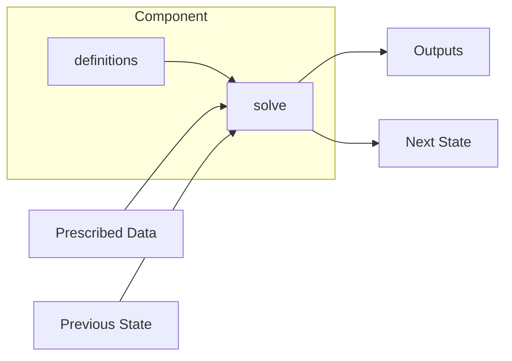
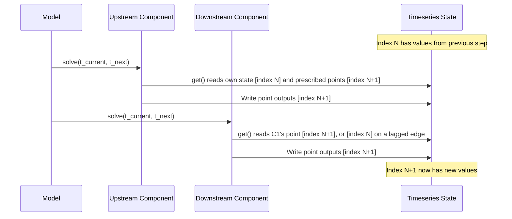
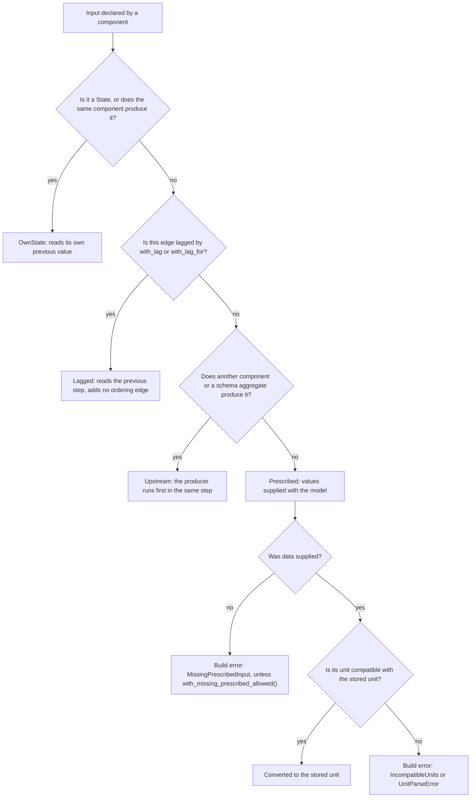

# Key Concepts

This page explains the core abstractions in RSCM: **Components**, **Models**, and **Timeseries**.

See the [Python API](api/rscm/index.md) for full class documentation.

## Components

Components are the fundamental building blocks of RSCM.
Each component encapsulates a specific piece of physics,
such as the carbon cycle, radiative forcing or temperature response,
that can be solved for a given step.

### What Components Do

A component:

- **Declares variables**: Defines the inputs it reads and the outputs it produces
- **Implements physics**: Contains the equations or algorithms for a particular process
- **Exchanges state**: Reads inputs from other components or prescribed data,
  writes outputs for downstream components

### Variable Roles

Each variable a component declares is a `VariableDefinition` with a **role** (`VariableRole`)
that defines how it flows through the model:

| Role     | Description                                                     | Read | Write |
| -------- | --------------------------------------------------------------- | ---- | ----- |
| `Input`  | Prescribed data or output from another component                | Yes  | No    |
| `Output` | New value produced each step                                    | No   | Yes   |
| `State`  | Reads previous value, writes new value (requires initial value) | Yes  | Yes   |

### Component Lifecycle



1. **Definition phase**: The component declares its inputs and outputs via `definitions()`
2. **Build phase**: The model builder validates that every declared input can be supplied
3. **Solve phase**: At each step, `solve(t_current, t_next, input_state)` is called

### Creating Components

In Python, subclass [`Component`][rscm.component.Component] and declare variables with
[`Input`][rscm.component.Input], [`Output`][rscm.component.Output] and [`State`][rscm.component.State].
In Rust, the `ComponentIO` derive macro generates the same declarations from attributes.

=== "Python"

    ```python
    from rscm.component import Component, Input, Output, State

    class SimpleCarbonCycle(Component):
        # Declare variables using descriptors
        emissions = Input("Emissions|CO2", unit="Mt CO2/yr")
        concentration = State("Atmospheric Concentrations|CO2", unit="ppm")
        uptake = Output("Net Atmosphere to Land Flux|CO2", unit="Mt CO2/yr")

        def __init__(self, sensitivity: float):
            self.sensitivity = sensitivity

        def solve(self, t_current, t_next, inputs):
            # get() returns the value the model wired each input to
            emis = inputs.emissions.get()
            conc_prev = inputs.concentration.get()

            # Return typed outputs
            return self.Outputs(
                concentration=conc_prev + emis * self.sensitivity,
                uptake=emis * 0.3,
            )
    ```

=== "Rust"

    ```rust
    #[derive(Debug, Serialize, Deserialize, ComponentIO)]
    #[inputs(
        emissions { name = "Emissions|CO2", unit = "Mt CO2/yr" },
    )]
    #[states(
        concentration { name = "Atmospheric Concentrations|CO2", unit = "ppm" },
    )]
    #[outputs(
        uptake { name = "Net Atmosphere to Land Flux|CO2", unit = "Mt CO2/yr" },
    )]
    pub struct SimpleCarbonCycle {
        pub sensitivity: f64,
    }

    #[typetag::serde]
    impl Component for SimpleCarbonCycle {
        fn definitions(&self) -> Vec<VariableDefinition> {
            Self::generated_definitions()
        }

        fn solve(&self, t_current: Time, t_next: Time, input_state: &InputState)
            -> RSCMResult<OutputState>
        {
            let inputs = SimpleCarbonCycleInputs::from_input_state(input_state);
            let emis = inputs.emissions.get();
            let conc_prev = inputs.concentration.get();

            let outputs = SimpleCarbonCycleOutputs {
                concentration: conc_prev + emis * self.sensitivity,
                uptake: emis * 0.3,
            };
            Ok(outputs.into())
        }
    }
    ```

The [Python Components](notebooks/component_python.py) and [Rust Components](notebooks/component_rust.md)
tutorials walk through writing a component and using it in a model.

## Models

A **Model** couples multiple components together,
managing the flow of state between them and stepping through time.

### ModelBuilder Pattern

Models are constructed using the [`ModelBuilder`][rscm.core.ModelBuilder] pattern:

```python
from rscm.core import ModelBuilder, TimeAxis, Timeseries
import numpy as np

model = (
    ModelBuilder()
    .with_time_axis(TimeAxis.from_values(np.arange(1750, 2101, 1.0)))
    .with_component(carbon_cycle)
    .with_component(temperature_response)
    .with_prescribed_variable("Emissions|CO2", emissions_ts)
    .with_initial_values({"Atmospheric Concentrations|CO2": 280.0})
).build()
```

### Dependency Graph

When you build a model, the builder constructs a **dependency graph**:

1. Each component becomes a node in the graph
2. Edges connect each producer of a variable to its consumers
3. Self-referential state variables are allowed (a component reading its own previous output)

The builder links producers once every component is registered,
so the order you add components in does not change the model.
Each variable has at most one producer.

A **feedback loop**, such as temperature feeding back on the carbon cycle,
needs one of its edges to read the previous step's value.
This is a **lag**, and the model wiring names it:

```python
builder.with_lag("Surface Air Temperature Change")  # every consumer reads last step's temperature
builder.with_lag_for("Atmospheric Concentrations|CO2", "OceanCarbon")  # only OceanCarbon lags
```

`with_lag(variable)` lags every edge from the variable.
`with_lag_for(variable, consumer)` lags one edge, so other consumers still see this step's value.
`consumer` is the component's type name, such as `"OceanCarbon"`.
A lag holds whether the variable is produced by a component or prescribed.

A loop that no lag breaks fails `build()` with an error that lists the components and variables in the loop,
and the `with_lag_for` calls that would break it.
Edges into a component that holds its own state come first.
The builder never chooses a lag itself.
Runners such as `run_magicc7` and `run_fair` carry their models' lags.

### Model Execution

Each step runs from `t_current` (index N) to `t_next` (index N+1).
Within a step the model solves every producer before its consumers,
using a topological sort of the graph.
Each component reads its inputs with `get()`.
It writes a point output to index N+1, the step's end,
and an average output to index N, the step's start
(see [Points and Averages](#points-and-averages)).
For points:



### Step Semantics

A component never chooses a time index.
It reads each input through three calls on the input's window:

- `get()` returns the value the model wired the input to.
- `interval()` returns a point's values at the start and end of the step, as a `(start, end)` pair.
- `history(n)` returns the value `n` steps before `get()`, so `history(0)` equals `get()`.
  It reads only the past, and returns `None` before the first step.

The builder decides which value `get()` returns, from how the model is wired:

| What you're reading                 | Who wrote it       | `get()` reads a point | `get()` reads an average |
| ----------------------------------- | ------------------ | --------------------- | ------------------------ |
| Your own previous state             | You, last step     | index N               | index N-1                |
| Prescribed input                    | Pre-populated      | index N+1             | index N                  |
| Upstream component output           | They ran this step | index N+1             | index N                  |
| Lagged input                        | Written last step  | index N               | not supported            |

A prescribed input reads the same index as an upstream output,
so a component reads the same value whether the variable is prescribed or modelled.
`with_lag(variable)` and `with_lag_for(variable, consumer)` make an edge read the previous step.
A lagged input's `get()` gives last step's value, and its `interval()` gives last step's start and end.
Adding a lag changes the model wiring, not the component.

`interval()` is an error on an average, which has one value per step,
and on a component's own state, whose end of step the component writes.
`get_time()` gives the time of the value `get()` returns,
and `history_len()` counts the values `history` can read.
A fixed calendar year, such as a reference year of prescribed data, is read with `interpolate(year)`.

=== "Python"

    ```python
    emis = inputs.emissions.get()
    erf_start, erf_end = inputs.erf.interval()
    emis_last_step = inputs.emissions.history(1)  # None in the first step
    ```

=== "Rust"

    ```rust
    let emis = inputs.emissions.get();
    let (erf_start, erf_end) = inputs.erf.interval()?;
    let emis_last_step = inputs.emissions.history(1); // None in the first step
    ```

Rust grid windows read one region with `get(region)` and every region with `get_all()`.
The component tutorials cover each call in more detail.

### Running a Model

```python
# Step through one step at a time
model.step()
print(f"Current time: {model.current_time_bounds()}")

# Or run to completion
model.run()

# Access results
results = model.timeseries()
temp = results.get_timeseries_by_name("Surface Air Temperature Change")
```

`step()` and `run()` raise `RuntimeError` when a component fails.
In Rust, `Model::try_step` and `Model::try_run` return the error, while `step` and `run` panic.
A failed step does not advance the time index, but components that already ran may have updated their state.
Rebuild the model before retrying.
An exception raised inside a Python component's `solve()` also surfaces as `RuntimeError`,
with the component name, step and Python traceback in the message.

### Running Many Models

`build_models` and `run_models` build and run a list of models in parallel on a rayon thread pool,
for ensembles of parameter sets or scenarios:

```python
from rscm.core import build_models, run_models

models = build_models([make_builder(p) for p in parameter_sets])
run_models(models)
```

Each model owns its state, so the results are the same as running the models in turn.
`n_threads` limits the thread count, and the default is one thread per core.
Python components hold the GIL while they solve, so models with Python components gain less.
`run_models` runs every model even when one fails,
then raises `RuntimeError` naming the first that failed.
In Rust, `rscm_core::model::build_models` and `run_models` return one result per model.

### Prescribed vs Modelled Variables

| Variable       | Source                       | Example                                 |
| -------------- | ---------------------------- | --------------------------------------- |
| **Prescribed** | Supplied to the model        | Emissions scenarios, prescribed forcing |
| **Modelled**   | Computed by model components | CO2 concentration, temperature          |

Whether a variable is prescribed or modelled is determined by the components in the model,
not by any intrinsic property of the variable itself.
During the build phase, the `ModelBuilder` analyses all component definitions to identify:

1. **Required inputs**: Variables that components need to read
2. **Produced outputs**: Variables that components write

Any required input that is not produced by another component in the model
must be supplied as prescribed data via `with_prescribed_variable()`.
The same variable can be prescribed in one model configuration and modelled in another,
depending on which components are included.

For example, CO2 concentration might be:

- **Modelled** in a full carbon-cycle model where a component calculates concentration from emissions
- **Prescribed** in a temperature-only model where concentration is prescribed directly

The builder collects every component's outputs and states first,
so the order components are added does not matter.
It then decides each input's source in this order, stopping at the first match:



`model.coupling()` shows the source the builder chose for every input.

`build()` raises `ValueError` if a prescribed input has no data and no initial value,
naming each missing variable and the components that read it.
`with_missing_prescribed_allowed()` builds the model anyway, with the missing inputs filled with NaN.
State variables are also checked: `build()` raises `ValueError` if one has no initial value.

Scalar prescribed data uses `with_prescribed_variable()` and scalar initial values use `with_initial_values()`.
Grid variables have their own methods:

- `with_prescribed_variable(name, FourBoxTimeseries(...))` supplies four-box prescribed data.
- `with_initial_grid_values({name: [...]})` sets the initial value of a grid state variable,
  with one value per region in grid order.

See [Gridded Prescribed Data and Initial Values](grids.md#gridded-prescribed-data-and-initial-values)
for examples.

### Points and Averages

Every variable is a point or an average.
A point holds at an instant, such as a concentration, a carbon pool or temperature.
An average holds over a whole step, such as emissions, a flux or a lifetime.

The unit sets the default.
A unit per time, such as `GtC/yr`, makes an average,
and anything else makes a point, including `W/m^2` and `yr`.
Declare the type where the default is wrong, as for a lifetime:

```python
class Chemistry(Component):
    lifetime = Output("Lifetime|CH4", unit="yr", timeseries_type="average")
```

In Rust, `ComponentIO` declarations take `timeseries_type = "average"`,
and `VariableDefinition::with_timeseries_type` sets it on a hand-written definition.

The producer decides the type and its consumers inherit it.
An input that declares a different type makes `build()` fail.
`ModelBuilder.with_timeseries_type(variable, TimeseriesType.Average)` declares the type of a prescribed variable.
Without it, a consumer's declaration or the unit decides.
`Model.timeseries_type(variable)` returns the resolved type.

State variables must be points, so `build()` fails for a state that resolves to an average.
`with_state_type_check(False)` turns the check off.

A point is stored at its time and an average at the start bound of its step,
whoever produced it.
Input files, IAMC data and MAGICC7 label annual emissions the same way,
so prescribing an average with values a model wrote for it gives the same results as modelling it.
An average a component writes has no value at the last time,
because no step starts there.

`get()` reads a point at the step's end, index N+1, whether it is prescribed or produced upstream.
A component's own state and a lagged edge read the step's start, index N.
`get()` reads an average at its own step, index N, and a component's own average at the step before.
A lag holds when the variable is prescribed,
so a prescribed run must declare the lags the coupled run declares.
`rscm.magicc.with_lags` adds MAGICC7's lags, and `rscm.fair.with_lags` adds FaIR's.
With those lags, prescribing a point or an average with values a model wrote for it
gives the same results as modelling it.

A lag on an average fails `build()` for now,
because the first step has no previous value to read.

The type sets the interpolation of each series the builder creates:
`Previous` for an average and `Linear` for a point.
Prescribed series keep the strategy they were given.

## Timeseries

RSCM uses [`Timeseries`][rscm.core.Timeseries] objects to represent time-varying data,
with support for different interpolation strategies.

### TimeAxis

A `TimeAxis` holds the ordered time bounds a timeseries is defined on:

```python
from rscm.core import TimeAxis
import numpy as np

# From values (assumes uniform spacing for last step)
time_axis = TimeAxis.from_values(np.arange(2000.0, 2101.0, 1.0))

# From explicit bounds (n+1 bounds for n steps)
time_axis = TimeAxis.from_bounds(np.array([2000.0, 2010.0, 2050.0, 2100.0]))
```

### Timeseries

A `Timeseries` combines values, time axis, unit, and interpolation strategy:

```python
from rscm.core import Timeseries, InterpolationStrategy

emissions = Timeseries(
    values=np.array([0.0, 10.0, 15.0]),
    time_axis=TimeAxis.from_values(np.array([1850.0, 2000.0, 2100.0])),
    unit="GtC/yr",
    interpolation_strategy=InterpolationStrategy.Linear,
)
```

### Interpolation Strategies

When the model time axis differs from the timeseries time axis,
values are interpolated according to the `InterpolationStrategy`:

| Strategy   | Behaviour                                     |
| ---------- | --------------------------------------------- |
| `Linear`   | Linear interpolation between points (default) |
| `Previous` | Step function using the previous value        |
| `Next`     | Step function using the next value            |

The `Timeseries` constructor requires a strategy.
`Timeseries.from_values` defaults to `Linear`.
`with_interpolation_strategy()` changes the strategy in place and returns `None`, so it cannot be chained.
`at_time()` interpolates a single value:

```python
ts = Timeseries(
    np.array([0.0, 10.0, 20.0]),
    TimeAxis.from_values(np.array([2000.0, 2010.0, 2020.0])),
    "GtC/yr",
    InterpolationStrategy.Linear,
)
ts.at_time(2005.0)  # 5.0
ts.at_time(2040.0)  # 40.0, extrapolated from the last segment

ts.with_interpolation_strategy(InterpolationStrategy.Previous)
ts.at_time(2005.0)  # 0.0
ts.at_time(2040.0)  # 20.0, the last value is held
```

Strategies created from Python always allow extrapolation outside the time axis.
`Linear` extends the first and last segments, which can produce negative values.
`Previous` and `Next` hold the end values.

Choose the strategy to match what the values represent:

- Use `Previous` for fluxes such as emissions, where each value applies over the following interval.
- Use `Linear` for state quantities such as concentrations or forcing sampled at points in time.

### TimeseriesCollection

A [`TimeseriesCollection`][rscm.core.TimeseriesCollection] holds multiple named timeseries:

```python
from rscm.core import TimeseriesCollection

collection = TimeseriesCollection()
collection.add_timeseries("Emissions|CO2", emissions_ts)
collection.add_timeseries("Surface Air Temperature Change", temp_ts)

# Access by name
ts = collection.get_timeseries_by_name("Emissions|CO2")
print(ts.values())
```

### Variable Names

A variable name is a list of segments joined by `|`, read from general to specific:
the quantity, then the species, then the sector, then any further breakdown.
For example `Emissions|CO2|Fossil` is the fossil sector of the CO2 emissions.

- A child segment is always a part or breakdown of its parent.
- Other qualifiers lead the first segment, as in `Prescribed Atmospheric Concentrations|CO2` or `Net Emissions|CO2`.
- The grid is metadata on the variable, not part of its name.
- A name never encodes a step position such as the start or end of a year. The timeseries type carries it.
- A statistic appears only when a point and an average form of the same quantity coexist,
  as a leading qualifier: `Annual Mean Surface Air Temperature Change`.
- Quantities are spelt out in full. Chemical formulae such as `CO2` and `NOx` stay as formulae.
- Emissions use the gcages mass basis: `Mt CO2/yr`, `Mt SO2/yr`, `Mt NO2/yr`, `kt N2O/yr`, `Mt VOC/yr`,
  `Mt CH4/yr` and `kt <halocarbon>/yr`.

Two names for gas in the atmosphere mean different things.
`Airborne Emissions|<species>` (FaIR) is the part of the cumulative emissions still in the atmosphere,
so it excludes the pre-industrial background.
`Atmospheric Burden|CH4|<source>` (MAGICC) is the CH4 mass in the atmosphere attributed to a source,
including the natural background under `Natural`.

`rscm.names` (`rscm_core::names` in Rust) holds the names that more than one component or module uses.
`rscm.names.convert_variable_name` maps MAGICC7 and RCMIP names, such as `Emissions|CO2|MAGICC AFOLU`,
to RSCM names.

## Variable Schema

A **VariableSchema** declares model variables and their aggregation relationships,
so derived values are computed automatically from multiple component outputs.

### Why Use Variable Schema?

When building climate models, you often need to aggregate multiple forcing agents into totals:

- Sum CO2, CH4, and N2O forcing into "Effective Radiative Forcing|Greenhouse Gases"
- Compute weighted averages across regions
- Build hierarchical aggregates (e.g., "Effective Radiative Forcing" from sub-totals)

Without a schema, you'd need to write custom aggregation components.
With VariableSchema, you declare the relationships and RSCM handles the rest.

### Declaring a Schema

```python
from rscm.core import VariableSchema

schema = VariableSchema()

# Declare individual variables
schema.add_variable("Effective Radiative Forcing|CO2", "W/m^2")
schema.add_variable("Effective Radiative Forcing|CH4", "W/m^2")
schema.add_variable("Effective Radiative Forcing|N2O", "W/m^2")

# Declare an aggregate and its contributors
schema.add_aggregate("Effective Radiative Forcing|Greenhouse Gases", "W/m^2", "sum", ["Effective Radiative Forcing|CO2", "Effective Radiative Forcing|CH4", "Effective Radiative Forcing|N2O"])

schema.validate()
```

`weighted_sum` aggregates also take a `weights` list with one weight per contributor.
In Rust, `VariableSchema::new()` offers a chained builder:
`.variable(...)` and `.aggregate(...).from(...).build()`.

### Aggregation Operations

| Operation      | Description                              |
| -------------- | ---------------------------------------- |
| `sum`          | Sum of all contributors                  |
| `mean`         | Arithmetic mean                          |
| `weighted_sum` | Sum of each contributor times its weight |

The Rust enum members are `AggregateOp::Sum`, `Mean` and `WeightedSum`.

### Using Schema with ModelBuilder

```python
model = (
    ModelBuilder()
    .with_time_axis(time_axis)
    .with_schema(schema)
    .with_component(co2_forcing)
    .with_component(ch4_forcing)
    .with_component(n2o_forcing)
    # ... prescribed data and initial values
).build()
```

During build, RSCM:

1. Validates that all aggregate contributors exist
2. Checks for circular dependencies
3. Adds a node to the dependency graph for each aggregate, which runs after its contributors
4. Ensures unit consistency between contributors and aggregates

### Key Behaviours

- **NaN handling**: Contributors with NaN values are excluded from computation (treated as missing data)
- **Hierarchical aggregates**: Aggregates can reference other aggregates as contributors
- **Partial models**: Schema variables with no producer remain NaN

For a complete walkthrough, see the [Variable Schemas tutorial](notebooks/variable_schema.py).

## Putting It Together

1. **Define components** with their inputs, outputs, and physics
2. **Build a model** using `ModelBuilder`, providing components, prescribed data, initial values and a schema
3. **Run the model** to generate results
4. **Extract timeseries** for analysis and visualisation
