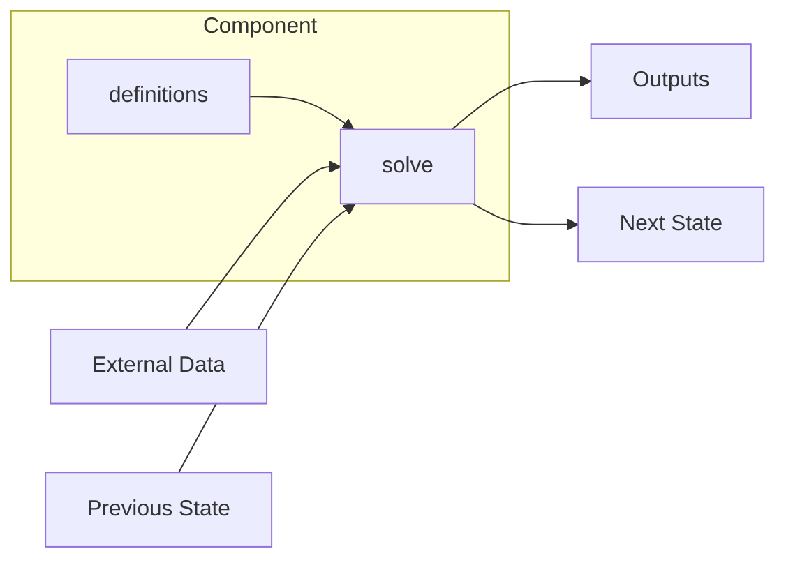
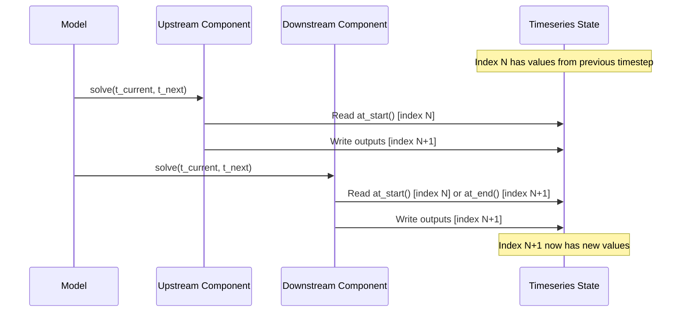

# Key Concepts

This page explains the core abstractions in RSCM: **Components**, **Models**, and **Timeseries**.

See the [Python API](api/rscm/index.md) for full class documentation.

## Components

Components are the fundamental building blocks of RSCM.
Each component encapsulates a specific piece of physics,
such as the carbon cycle, radiative forcing or temperature response,
that can be solved for a given timestep.

### What Components Do

A component:

- **Declares requirements**: Specifies what inputs it needs and what outputs it produces
- **Implements physics**: Contains the equations or algorithms for a particular process
- **Exchanges state**: Reads inputs from other components or exogenous data,
  writes outputs for downstream components

### Requirement Types

Each variable in a component has a **requirement type** that defines how it flows through the model:

| Type     | Description                                                     | Read | Write |
| -------- | --------------------------------------------------------------- | ---- | ----- |
| `Input`  | External data or output from another component                  | Yes  | No    |
| `Output` | New value produced each timestep                                | No   | Yes   |
| `State`  | Reads previous value, writes new value (requires initial value) | Yes  | Yes   |

### Component Lifecycle



1. **Definition phase**: The component declares its inputs and outputs via `definitions()`
2. **Build phase**: The model builder validates that all requirements can be satisfied
3. **Solve phase**: At each timestep, `solve(t_current, t_next, input_state)` is called

### Creating Components

In Python, subclass [`Component`][rscm.component.Component] and declare variables with
[`Input`][rscm.component.Input], [`Output`][rscm.component.Output] and [`State`][rscm.component.State].
In Rust, the `ComponentIO` derive macro generates the same declarations from attributes.

=== "Python"

    ```python
    from rscm.component import Component, Input, Output, State

    class SimpleCarbonCycle(Component):
        # Declare requirements using descriptors
        emissions = Input("Emissions|CO2", unit="GtCO2")
        concentration = State("Atmospheric Concentration|CO2", unit="ppm")
        uptake = Output("Land Uptake|CO2", unit="GtC")

        def __init__(self, sensitivity: float):
            self.sensitivity = sensitivity

        def solve(self, t_current, t_next, inputs):
            # Access values at start of timestep (index N)
            emis = inputs.emissions.at_start()
            conc_prev = inputs.concentration.at_start()

            # Return typed outputs
            return self.Outputs(
                concentration=conc_prev + emis * self.sensitivity,
                uptake=emis * 0.3,
            )
    ```

=== "Rust"

    ```rust
    #[derive(Debug, Serialize, Deserialize, ComponentIO)]
    #[inputs(
        emissions { name = "Emissions|CO2", unit = "GtCO2" },
    )]
    #[states(
        concentration { name = "Atmospheric Concentration|CO2", unit = "ppm" },
    )]
    #[outputs(
        uptake { name = "Land Uptake|CO2", unit = "GtC" },
    )]
    pub struct SimpleCarbonCycle {
        pub sensitivity: f64,
    }

    #[typetag::serde]
    impl Component for SimpleCarbonCycle {
        fn definitions(&self) -> Vec<RequirementDefinition> {
            Self::generated_definitions()
        }

        fn solve(&self, t_current: Time, t_next: Time, input_state: &InputState)
            -> RSCMResult<OutputState>
        {
            let inputs = SimpleCarbonCycleInputs::from_input_state(input_state);
            let emis = inputs.emissions.at_start();
            let conc_prev = inputs.concentration.at_start();

            let outputs = SimpleCarbonCycleOutputs {
                concentration: conc_prev + emis * self.sensitivity,
                uptake: emis * 0.3,
            };
            Ok(outputs.into())
        }
    }
    ```

The [Python Components](notebooks/component_python.py) and [Rust Components](notebooks/component_rust.md)
tutorials walk through writing a component and using it in a model.

## Models

A **Model** couples multiple components together,
managing the flow of state between them and stepping through time.

### ModelBuilder Pattern

Models are constructed using the [`ModelBuilder`][rscm.core.ModelBuilder] pattern:

```python
from rscm.core import ModelBuilder, TimeAxis, Timeseries
import numpy as np

model = (
    ModelBuilder()
    .with_time_axis(TimeAxis.from_values(np.arange(1750, 2101, 1.0)))
    .with_rust_component(carbon_cycle)
    .with_rust_component(temperature_response)
    .with_exogenous_variable("Emissions|CO2", emissions_ts)
    .with_initial_values({"Atmospheric Concentration|CO2": 280.0})
).build()
```

### Dependency Graph

When you add components to a model, the builder constructs a **dependency graph**:

1. Each component becomes a node in the graph
2. Edges connect components that share variables (producer -> consumer)
3. The graph must be acyclic (no circular dependencies between components)
4. Self-referential state variables are allowed (a component reading its own previous output)

Edges are only created to producers that were added to the builder before the consumer.
If a consumer is added first, it has no edge to that producer and reads the value from the previous timestep.
Add components in producer-to-consumer order to couple them within a timestep.
Feedback loops, such as temperature feeding back on the carbon cycle,
necessarily read one side from the previous timestep.

### Model Execution

Each timestep runs from `t_current` (index N) to `t_next` (index N+1).
Within a timestep the model solves every producer before its consumers,
using a topological sort of the graph.
Each component reads the values at index N and writes its outputs to index N+1:



### Timestep Semantics

A component reads each input from one end of the timestep:

| What you're reading                | Who wrote it           | Method       |
| ---------------------------------- | ---------------------- | ------------ |
| Your own previous state            | You, last timestep     | `at_start()` |
| Exogenous input (external forcing) | Pre-populated          | `at_start()` |
| Upstream component output          | They ran this timestep | `at_end()`   |

`at_end()` returns `None` at the final timestep, because there is no index N+1.
In Rust, `get()` applies this table and falls back to `at_start()` at the final timestep:

```rust
let erf = inputs.erf.at_end().unwrap_or_else(|| inputs.erf.at_start());
let erf = inputs.erf.get(); // same value for an upstream output
```

/// warning | Python components
The windows passed to Python components currently only hold values up to index N.
`at_end()` returns `None` at every timestep in a Python component.
A Python component reads an upstream output with `at_start()`, so it sees the value from the previous step.
///

The component tutorials list every accessor, including `at_offset()` and `last_n()`.

### Running a Model

```python
# Step through one timestep at a time
model.step()
print(f"Current time: {model.current_time_bounds()}")

# Or run to completion
model.run()

# Access results
results = model.timeseries()
temp = results.get_timeseries_by_name("Surface Temperature")
```

`step()` and `run()` raise `RuntimeError` when a component fails.
In Rust, `Model::try_step` and `Model::try_run` return the error, while `step` and `run` panic.
A failed step does not advance the time index, but components that already ran may have updated their state.
Rebuild the model before retrying.
An exception raised inside a Python component's `solve()` currently surfaces as `pyo3_runtime.PanicException`,
not `RuntimeError`.

### Exogenous vs Endogenous Variables

| Variable Type  | Source                       | Example                                 |
| -------------- | ---------------------------- | --------------------------------------- |
| **Exogenous**  | Provided externally          | Emissions scenarios, prescribed forcing |
| **Endogenous** | Computed by model components | CO2 concentration, temperature          |

Whether a variable is exogenous or endogenous is determined by the components in the model,
not by any intrinsic property of the variable itself.
During the build phase, the `ModelBuilder` analyses all component definitions to identify:

1. **Required inputs**: Variables that components need to read
2. **Produced outputs**: Variables that components write

Any required input that is not produced by another component in the model
must be supplied as exogenous data via `with_exogenous_variable()`.
The same variable can be exogenous in one model configuration and endogenous in another,
depending on which components are included.

For example, CO2 concentration might be:

- **Endogenous** in a full carbon-cycle model where a component calculates concentration from emissions
- **Exogenous** in a temperature-only model where concentration is prescribed directly

The builder does not check that exogenous inputs were supplied.
A missing exogenous input is NaN, and the NaN propagates through every component that reads it.
State variables are checked: `build()` raises `ValueError` if one has no initial value.

Scalar exogenous data uses `with_exogenous_variable()` and scalar initial values use `with_initial_values()`.
Grid variables have their own methods:

- `with_exogenous_four_box_variable(name, FourBoxTimeseries(...))` supplies FourBox exogenous data.
- `with_initial_grid_values({name: [...]})` sets the initial value of a grid state variable,
  with one value per region in grid order.

See [Gridded Exogenous Data and Initial Values](grids.md#gridded-exogenous-data-and-initial-values)
for examples.

## Timeseries

RSCM uses [`Timeseries`][rscm.core.Timeseries] objects to represent time-varying data,
with support for different interpolation strategies.

### TimeAxis

A `TimeAxis` defines the temporal grid for a timeseries:

```python
from rscm.core import TimeAxis
import numpy as np

# From values (assumes uniform spacing for last step)
time_axis = TimeAxis.from_values(np.arange(2000.0, 2101.0, 1.0))

# From explicit bounds (n+1 bounds for n timesteps)
time_axis = TimeAxis.from_bounds(np.array([2000.0, 2010.0, 2050.0, 2100.0]))
```

### Timeseries

A `Timeseries` combines values, time axis, units, and interpolation strategy:

```python
from rscm.core import Timeseries, InterpolationStrategy

emissions = Timeseries(
    values=np.array([0.0, 10.0, 15.0]),
    time_axis=TimeAxis.from_values(np.array([1850.0, 2000.0, 2100.0])),
    units="GtC / yr",
    interpolation_strategy=InterpolationStrategy.Linear,
)
```

### Interpolation Strategies

When the model time axis differs from the timeseries time axis,
values are interpolated according to the `InterpolationStrategy`:

| Strategy   | Behaviour                                     |
| ---------- | --------------------------------------------- |
| `Linear`   | Linear interpolation between points (default) |
| `Previous` | Step function using the previous value        |
| `Next`     | Step function using the next value            |

The `Timeseries` constructor requires a strategy.
`Timeseries.from_values` defaults to `Linear`.
`with_interpolation_strategy()` changes the strategy in place and returns `None`, so it cannot be chained.
`at_time()` interpolates a single value:

```python
ts = Timeseries(
    np.array([0.0, 10.0, 20.0]),
    TimeAxis.from_values(np.array([2000.0, 2010.0, 2020.0])),
    "GtC / yr",
    InterpolationStrategy.Linear,
)
ts.at_time(2005.0)  # 5.0
ts.at_time(2040.0)  # 40.0, extrapolated from the last segment

ts.with_interpolation_strategy(InterpolationStrategy.Previous)
ts.at_time(2005.0)  # 0.0
ts.at_time(2040.0)  # 20.0, the last value is held
```

Strategies created from Python always allow extrapolation outside the time axis.
`Linear` extends the first and last segments, which can produce negative values.
`Previous` and `Next` hold the end values.

Choose the strategy to match what the values represent:

- Use `Previous` for fluxes such as emissions, where each value applies over the following interval.
- Use `Linear` for state quantities such as concentrations or forcing sampled at points in time.

### TimeseriesCollection

A [`TimeseriesCollection`][rscm.core.TimeseriesCollection] holds multiple named timeseries:

```python
from rscm.core import TimeseriesCollection

collection = TimeseriesCollection()
collection.add_timeseries("Emissions|CO2", emissions_ts)
collection.add_timeseries("Surface Temperature", temp_ts)

# Access by name
ts = collection.get_timeseries_by_name("Emissions|CO2")
print(ts.values())
```

## Variable Schema

A **VariableSchema** declares model variables and their aggregation relationships,
so derived values are computed automatically from multiple component outputs.

### Why Use Variable Schema?

When building climate models, you often need to aggregate multiple forcing agents into totals:

- Sum CO2, CH4, and N2O forcing into "GHG Forcing"
- Compute weighted averages across regions
- Build hierarchical aggregates (e.g., "Total Forcing" from sub-totals)

Without a schema, you'd need to write custom aggregation components.
With VariableSchema, you declare the relationships and RSCM handles the rest.

### Declaring a Schema

```python
from rscm.core import VariableSchema

schema = VariableSchema()

# Declare individual variables
schema.add_variable("ERF|CO2", "W/m^2")
schema.add_variable("ERF|CH4", "W/m^2")
schema.add_variable("ERF|N2O", "W/m^2")

# Declare an aggregate and its contributors
schema.add_aggregate("ERF|GHG", "W/m^2", "Sum", ["ERF|CO2", "ERF|CH4", "ERF|N2O"])

schema.validate()
```

`Weighted` aggregates also take a `weights` list with one weight per contributor.
In Rust, `VariableSchema::new()` offers a chained builder:
`.variable(...)` and `.aggregate(...).from(...).build()`.

### Aggregation Operations

| Operation  | Description                         |
| ---------- | ----------------------------------- |
| `Sum`      | Sum of all contributors             |
| `Mean`     | Arithmetic mean                     |
| `Weighted` | Weighted average (requires weights) |

### Using Schema with ModelBuilder

```python
model = (
    ModelBuilder()
    .with_time_axis(time_axis)
    .with_schema(schema)
    .with_rust_component(co2_forcing)
    .with_rust_component(ch4_forcing)
    .with_rust_component(n2o_forcing)
    # ... exogenous data and initial values
).build()
```

During build, RSCM:

1. Validates that all aggregate contributors exist
2. Checks for circular dependencies
3. Inserts virtual aggregator components into the dependency graph
4. Ensures unit consistency between contributors and aggregates

### Key Behaviours

- **NaN handling**: Contributors with NaN values are excluded from computation (treated as missing data)
- **Hierarchical aggregates**: Aggregates can reference other aggregates as contributors
- **Partial models**: Schema variables with no writer component remain NaN

For a complete walkthrough, see the [Variable Schemas tutorial](notebooks/variable_schema.py).

## Putting It Together

1. **Define components** with their inputs, outputs, and physics
2. **Build a model** using `ModelBuilder`, providing components, exogenous data, initial values and a schema
3. **Run the model** to generate results
4. **Extract timeseries** for analysis and visualisation
