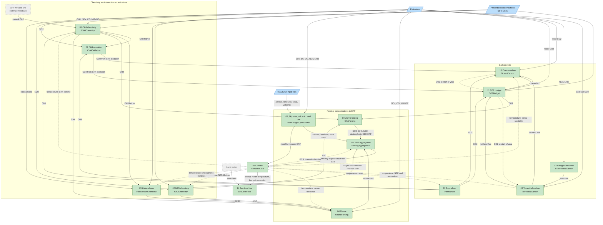

# MAGICC Module Documentation

This directory contains detailed documentation for each scientific module in MAGICC (Model for the Assessment of Greenhouse Gas Induced Climate Change). These documents are intended to guide the Rust reimplementation while maintaining scientific parity with the Fortran original.

For runnable concentration-driven and emissions-driven experiments, see [MAGICC runs](../magicc_runs.md).
The module pages describe the MAGICC7 Fortran.
The tables below record how far RSCM has ported each module.

## RSCM Implementation Status

Status levels:

- **Implemented**: the component follows the MAGICC7 module,
  and a regression test checks it against MAGICC7 v7.5.3 output.
- **Partial**: a component exists but simplifies the MAGICC7 physics and has no MAGICC7 parity test.

Rust components live in `crates/rscm-magicc/src/`, and source paths below are relative to it.
Each component has a Python builder in `rscm.magicc`, typed in `python/rscm/_lib/magicc.pyi`.
Parity tests are in `tests/regression/test_full_run.py` unless the row names another file.
They compare with MAGICC7's full-precision binary output at a relative tolerance of 1e-9
(absolute 1e-12), set in `tests/regression/full_run.py`.

| Module                                                       | Status      | RSCM component                                                                         | Source                                                         | MAGICC7 parity evidence                                                                                                                                                                       | Issue |
| ------------------------------------------------------------ | ----------- | -------------------------------------------------------------------------------------- | -------------------------------------------------------------- | --------------------------------------------------------------------------------------------------------------------------------------------------------------------------------------------- | ----- |
| [00 Initialization](module_00_initialization.md)             | Implemented | `ModelBuilder`, LAMCALC inside `ClimateUDEB`, `natural_emissions`                      | `climate/lamcalc.rs`, `python/rscm/magicc/full.py`             | Every coupled run starts from it. `tests/test_magicc_full.py` checks that the natural emissions close the CH4 and N2O budgets                                                                 | -     |
| [01 CH4 Chemistry](module_01_ch4_chemistry.md)               | Implemented | `CH4Chemistry`                                                                         | `chemistry/ch4.rs`                                             | `test_coupled_run` and `test_run_magicc7_defaults`: CH4 concentration                                                                                                                         | #109  |
| [01 CH4 oxidation to CO2](module_01_ch4_chemistry.md)        | Implemented | `CH4Oxidation`                                                                         | `chemistry/ch4_oxidation.rs`                                   | `test_coupled_run`: CO2 concentration                                                                                                                                                         | #109  |
| [02 N2O Chemistry](module_02_n2o_chemistry.md)               | Implemented | `N2OChemistry`                                                                         | `chemistry/n2o.rs`                                             | `test_coupled_run` and `test_run_magicc7_defaults`: N2O concentration                                                                                                                         | #109  |
| [03 Halocarbon Chemistry](module_03_halocarbon_chemistry.md) | Implemented | `HalocarbonChemistry`                                                                  | `chemistry/halocarbon.rs`                                      | `test_halocarbons`: 41 concentrations, F-gas and Montreal Protocol ERF, and EESC. `test_run_magicc7_defaults`: every concentration                                                            | #109  |
| [04 Ozone](module_04_ozone.md)                               | Implemented | `OzoneForcing`                                                                         | `forcing/ozone.rs`                                             | `test_ozone`: stratospheric, four-box tropospheric, N2O-induced and temperature-induced ozone ERF                                                                                             | #110  |
| [05 Aerosol Direct](module_05_aerosol_direct.md)             | Implemented | `rscm.magicc.prescribed`: `direct_aerosol`, `nitrate`, `mineral_dust`, `bc_on_snow`    | `python/rscm/magicc/prescribed.py`                             | `test_prescribed_forcing`: SOx, BC, OC and nitrate for each source, mineral dust and BC on snow                                                                                               | #110  |
| [06 Aerosol Indirect](module_06_aerosol_indirect.md)         | Implemented | `rscm.magicc.prescribed.cloud_albedo`                                                  | `python/rscm/magicc/prescribed.py`                             | `test_prescribed_forcing[Cloud Albedo]`                                                                                                                                                       | #110  |
| 05 and 06 as Rust components                                 | Partial     | `AerosolDirect`, `AerosolIndirect`                                                     | `forcing/aerosol_direct.rs`, `forcing/aerosol_indirect.rs`     | None. Simplified, and `run_magicc7` does not use them                                                                                                                                         | #110  |
| [07a GHG Forcing](module_07a_ghg_forcing.md)                 | Implemented | `GhgForcing`                                                                           | `forcing/ghg.rs`                                               | `test_ch4_oxidation_strat_h2o`. `test_coupled_run`: total ERF with OLBL, and with IPCCTAR in `ipcctar`                                                                                        | -     |
| [07b RF Aggregation](module_07b_rf_aggregation.md)           | Implemented | `ForcingAggregation`                                                                   | `forcing/aggregation.rs`                                       | `test_coupled_run`: total ERF and temperature, including `no_efficacy` and `prescribed_efficacy`                                                                                              | #114  |
| [08 Climate](module_08_climate.md)                           | Implemented | `ClimateUDEB`                                                                          | `climate/udeb/`, `climate/lamcalc.rs`                          | `test_climate` from MAGICC7's own box forcing. `test_coupled_run` variants on sensitivity, upwelling, diffusivity, ocean geometry, ground heat, interhemispheric exchange and feedback       | #108  |
| [09 Terrestrial Carbon](module_09_terrestrial_carbon.md)     | Implemented | `TerrestrialCarbon`                                                                    | `carbon/terrestrial.rs`                                        | `test_coupled_run`: CO2, including `gifford_fertilisation`, `respiration_fertscale` and `no_carbon_temperature_feedback`                                                                      | #109  |
| [10 Ocean Carbon](module_10_ocean_carbon.md)                 | Implemented | `OceanCarbon`                                                                          | `carbon/ocean.rs`                                              | `test_coupled_run`: CO2 concentration                                                                                                                                                         | #109  |
| [11 CO2 Budget](module_11_co2_budget.md)                     | Implemented | `CO2Budget`                                                                            | `carbon/budget.rs`                                             | `test_coupled_run`: CO2 from emissions. `test_run_magicc7_defaults`: CO2 prescribed up to 2015                                                                                                | #109  |
| [12 Permafrost](module_12_permafrost.md)                     | Implemented | `Permafrost`                                                                           | `carbon/permafrost.rs`                                         | `test_permafrost`: thawed area and CO2 and CH4 emissions. `test_coupled_run[permafrost]`                                                                                                      | #115  |
| [13 Nitrogen Limitation](module_13_nitrogen_limitation.md)   | Implemented | `TerrestrialCarbon` with `nitrogen`                                                    | `carbon/nitrogen.rs`                                           | `test_nitrogen_coupled_run`: limitation factor, nitrogen pool and NPP at relative 1e-4 (MAGICC7 writes them only as text), temperature and concentrations at 1e-9                             | #116  |
| [14 Sea Level Rise](module_14_sea_level_rise.md)             | Implemented | `SeaLevelRise`, thermal expansion in `ClimateUDEB`                                     | `climate/sea_level.rs`, `climate/udeb/`                        | `tests/regression/test_sea_level.py::test_contribution`: each contribution and the total                                                                                                      | #117  |
| [15 Main Timestep](module_15_main_timestep.md)               | Implemented | `Model`, `run_magicc7`                                                                 | `python/rscm/magicc/full.py`                                   | `test_run_magicc7_defaults`: temperature, every concentration and total ERF. `test_run_magicc7_rejects_bad_emissions`                                                                         | #105  |
| Volcanic and solar forcing                                   | Implemented | `rscm.magicc.prescribed`: `solar`, `volcanic_pattern`, `volcanic_substeps`             | `python/rscm/magicc/prescribed.py`, `climate/udeb/`            | `test_prescribed_forcing[Solar]`. Volcanic through `test_coupled_run` temperature. `tests/test_magicc_prescribed.py` checks the volcanic pattern                                              | #106  |
| Land-use albedo forcing                                      | Implemented | `rscm.magicc.prescribed.land_use`                                                      | `python/rscm/magicc/prescribed.py`                             | `test_prescribed_forcing[Land Use]`                                                                                                                                                           | #107  |

MAGICC7 calculates the historical aerosol, land-use, solar and volcanic forcing before the run
from its input files and emissions.
`rscm.magicc.prescribed` reproduces those calculations in Python and `ForcingAggregation`
combines them with the calculated agents.
Nitrate is split between industrial and AFOLU sources by each source's NOx times NH3 emissions.
Monthly volcanic forcing enters `ClimateUDEB` through its `subannual_forcing` parameter.

### Coupled runs

Three Python runners chain the components.
See [MAGICC runs](../magicc_runs.md) for usage.

- `rscm.magicc.full.run_magicc7` runs the whole chain with MAGICC7's defaults.
  It couples every component above except the Rust aerosol components.
  `pf_apply` adds `Permafrost`, `ncycle_apply` nitrogen limitation and `out_sealevel` `SeaLevelRise`.
- `rscm.magicc.run_magicc` couples `GhgForcing` and `ClimateUDEB` from prescribed concentrations.
  An optional CO2 mode adds `CO2Budget` with prescribed land and ocean uptake.
- `rscm.magicc.run_magicc_emissions` couples `CH4Chemistry`, `CH4Oxidation`, `N2OChemistry`,
  `TerrestrialCarbon`, `OceanCarbon`, `CO2Budget`, `GhgForcing` and `ClimateUDEB`.
  Other forcing enters as a prescribed residual, `Effective Radiative Forcing|Other`.

Like MAGICC7, `run_magicc7` prescribes concentrations up to 2015
and calculates them from emissions afterwards.
`test_full_run.py` checks it from SSP245 emissions against MAGICC7 v7.5.3.
The aim is scientific parity, so the tests compare at a relative tolerance of 1e-9.
MAGICC7's default run, and the emissions-driven runs with permafrost, nitrogen limitation
or sea level rise, currently match to the last bit from 1750 to 2104.
The variants each change one MAGICC7 switch on the emissions-driven run:
climate sensitivity, ocean upwelling, diffusivity and geometry, feedbacks, efficacies,
`core_co2ch4n2o_rfmethod`, CO2 fertilisation, respiration fertilisation scaling
and the carbon cycle temperature feedback.
They stay within 7.1e-15 K and a relative 1.4e-15 in CO2, CH4 and N2O.
The remaining differences come from the order of floating-point operations in the detritus pool.

`run_magicc_emissions` has no MAGICC7 regression test.
`tests/regression/magicc_baseline.py` compares `run_magicc` with a concentration-driven SSP245 fixture,
but it reports differences without a pass threshold.

### Known gaps

These come from the "Differences from MAGICC7" notes in each component's Rust documentation.

- **00 Initialization**: CH4 and N2O natural emissions are fixed component parameters.
  `rscm.magicc.full.natural_emissions` calculates MAGICC7's budget-closing values,
  and `run_magicc7` uses them.
- **01 CH4 Chemistry**: no wetland or clathrate feedback.
- **04 Ozone**: aviation NOx is not separated from other NOx.
- **05 and 06**: the Rust `AerosolDirect` and `AerosolIndirect` components are simplified, global and unused.
- **08 Climate**: no El Niño or AMV modes.
  The last year runs 12 substeps where MAGICC7 runs 11.
  See [time conventions](time_conventions.md).
- **09 Terrestrial Carbon**: `run_magicc7` supports only `co2_plantboxresp_method` 2.
- **10 Ocean Carbon**: no BOXDIFF IRF, radiative-only mode, biological pump or circulation change.
- **11 CO2 Budget**: no concentration cap, and no inverse fossil emissions while CO2 is prescribed.
- **14 Sea Level Rise**: no land water, semi-empirical method, FETTWEIS or DECONTO alternatives,
  or anomalies to 1986 to 2005.

## Module Dependency Graph

Solid arrows carry values within a timestep.
Dashed arrows carry the previous boundary's value, as in MAGICC7's staggered scheme:
chemistry and the carbon cycle use temperature and CO2 at the start of each year.
Green modules are implemented and grey dashed ones are not.
Blue nodes are inputs.



The Rust aerosol components are left out because no runner uses them.

## Architecture Overview

MAGICC is a reduced-complexity climate model that chains several Initial Value Problems (IVPs):

```
EMISSIONS -> CONCENTRATIONS -> RADIATIVE FORCING -> TEMPERATURE -> CARBON CYCLE FEEDBACKS
                                                       ↑                    |
                                                       └────────────────────┘
```

**Key Architectural Finding:** The "feedback loop" is NOT iterative within a timestep. MAGICC uses a **staggered explicit scheme** where carbon cycle uses T(t-1) to compute fluxes for year t. This means modules CAN be standalone steps with clear input/output contracts.

## Time Index Convention

| Variable Type  | Index Convention | Example                                  |
| -------------- | ---------------- | ---------------------------------------- |
| Concentrations | Start-of-year    | CO2(1750) = concentration at Jan 1, 1750 |
| Emissions      | Mid-year         | E(1750) = emissions during year 1750     |
| Temperature    | Start-of-year    | T(1750) = temp at Jan 1, 1750            |
| Forcing        | Start-of-year    | RF(1750) = forcing at Jan 1, 1750        |

## Spatial Structure

MAGICC uses a 4-box spatial discretization (hardcoded):

- **NH-Land** (Northern Hemisphere Land)
- **NH-Ocean** (Northern Hemisphere Ocean)
- **SH-Land** (Southern Hemisphere Land)
- **SH-Ocean** (Southern Hemisphere Ocean)

## Module Summary

### Core Pathway (Critical for any run)

| Module                                               | File                      | Purpose                                     | Iteration Type      |
| ---------------------------------------------------- | ------------------------- | ------------------------------------------- | ------------------- |
| [00 - Initialization](module_00_initialization.md)   | `MAGICC7.f90`             | Initialize DATASTORE, geography, parameters | One-time            |
| [15 - Main Timestep](module_15_main_timestep.md)     | `MAGICC7.f90`             | Orchestrate annual stepping                 | Sequential          |
| [07b - RF Aggregation](module_07b_rf_aggregation.md) | `deltaq_calculations.f90` | Sum forcing agents, apply efficacies        | None                |
| [08 - Climate](module_08_climate.md)                 | `climate_and_ocean.f90`   | Energy balance, ocean heat uptake           | 12 monthly substeps |

### Chemistry Modules (Emissions -> Concentrations)

| Module                                                         | File                      | Purpose                                    | Iteration Type       |
| -------------------------------------------------------------- | ------------------------- | ------------------------------------------ | -------------------- |
| [01 - CH4 Chemistry](module_01_ch4_chemistry.md)               | `methane.f90`             | CH4 concentration with OH feedback         | 4 Prather iterations |
| [02 - N2O Chemistry](module_02_n2o_chemistry.md)               | `n2o.f90`                 | N2O concentration with stratospheric delay | 4 iterations         |
| [03 - Halocarbon Chemistry](module_03_halocarbon_chemistry.md) | `deltaq_calculations.f90` | ~41 species exponential decay              | None                 |
| [04 - Ozone](module_04_ozone.md)                               | `deltaq_calculations.f90` | Tropospheric + stratospheric O3            | None                 |

### Forcing Modules (Concentrations -> W/m^2)

| Module                                                 | File                      | Purpose                       | Swappable Methods       |
| ------------------------------------------------------ | ------------------------- | ----------------------------- | ----------------------- |
| [07a - GHG Forcing](module_07a_ghg_forcing.md)         | `deltaq_calculations.f90` | CO2, CH4, N2O forcing         | IPCCTAR vs OLBL         |
| [05 - Aerosol Direct](module_05_aerosol_direct.md)     | `radiative_forcing.f90`   | BC, OC, SOx, dust, nitrate    | File-based + calculated |
| [06 - Aerosol Indirect](module_06_aerosol_indirect.md) | `cloudstore.f90`          | Cloud albedo/lifetime effects | File-based              |

### Carbon Cycle Modules (Feedbacks)

| Module                                                     | File                       | Purpose                  | Key Feature                        |
| ---------------------------------------------------------- | -------------------------- | ------------------------ | ---------------------------------- |
| [09 - Terrestrial Carbon](module_09_terrestrial_carbon.md) | `carbon_cycle.f90`         | 3-pool land carbon model | CO2 fertilization, Q10 respiration |
| [10 - Ocean Carbon](module_10_ocean_carbon.md)             | `carbon_cycle_ocean/*.f90` | Ocean CO2 uptake         | IRF models (BERN, HILDA, etc.)     |
| [11 - CO2 Budget](module_11_co2_budget.md)                 | `MAGICC7.f90`              | Mass balance integrator  | Closes carbon loop                 |

### Experimental Modules

| Module                                                       | File                      | Purpose                     | Status       |
| ------------------------------------------------------------ | ------------------------- | --------------------------- | ------------ |
| [12 - Permafrost](module_12_permafrost.md)                   | `permafrost.f90`          | Thaw-driven CH4/CO2 release | Experimental |
| [13 - Nitrogen Limitation](module_13_nitrogen_limitation.md) | `nitrogen_limitation.f90` | N constraint on NPP         | Experimental |
| [14 - Sea Level Rise](module_14_sea_level_rise.md)           | `sealevel.f90`            | Thermal + ice sheet SLR     | Experimental |

## Iteration Analysis

### Within-Module Iterations (Must Preserve for Parity)

| Module        | Iteration Type         | Count  | Why Required                          |
| ------------- | ---------------------- | ------ | ------------------------------------- |
| CH4 Chemistry | Prather fixed-point    | 4      | τ depends on B, implicit equation     |
| N2O Chemistry | Fixed-point            | 4      | Same pattern as CH4                   |
| N-Limitation  | Bisection root-finding | ~20    | Steady-state N pool                   |
| LAMCALC       | Secant/bisection       | ~10-20 | Find λ satisfying ECS+RLO (init only) |

### Sub-Annual Stepping (Hidden from Interface)

| Module         | Substeps          | Why                                    |
| -------------- | ----------------- | -------------------------------------- |
| Climate (UDEB) | 12/year (monthly) | Numerical stability of ocean diffusion |
| Ocean Carbon   | 12/year (monthly) | Stability of air-sea flux              |

## Key Fortran Files

| File                       | Lines   | Contents                          |
| -------------------------- | ------- | --------------------------------- |
| `MAGICC7.f90`              | ~12,599 | Main loop, DELTAQ, initialization |
| `deltaq_calculations.f90`  | ~1,605  | All forcing formulas              |
| `climate_and_ocean.f90`    | ~294    | Ocean diffusion, 4-box temps      |
| `methane.f90`              | ~234    | CH4 chemistry                     |
| `n2o.f90`                  | ~200    | N2O chemistry                     |
| `carbon_cycle.f90`         | ~197    | 3-pool terrestrial model          |
| `carbon_cycle_ocean/*.f90` | ~599    | IRF ocean models                  |
| `permafrost.f90`           | ~931    | Permafrost thaw/decomposition     |
| `sealevel.f90`             | ~831    | Ice sheet dynamics                |
| `cloudstore.f90`           | ~916    | Indirect aerosol effects          |
| `nitrogen_limitation.f90`  | ~396    | NPP constraint                    |
| `allcfgs.f90`              | ~2000   | All 500+ parameters               |

## Document Structure

Each module document follows this structure:

1. **Scientific Purpose** - What physical process is modeled
2. **Mathematical Formulation** - Governing equations in LaTeX
3. **State Variables** - Variables that persist between timesteps
4. **Parameters** - Configurable constants from CFG files
5. **Inputs/Outputs** - Interface contract with other modules
6. **Algorithm** - Step-by-step pseudocode matching Fortran
7. **Fortran Code References** - Specific file:line references
8. **Numerical Considerations** - Stability, edge cases
9. **Test Cases** - Validation approach

## RSCM Framework Compatibility

The [RSCM framework](https://github.com/lewisjared/rscm) provides the infrastructure
the MAGICC components need:

| Feature             | RSCM Status | Notes                                                         |
| ------------------- | ----------- | ------------------------------------------------------------- |
| Component trait     | Yes         | `solve(t, t_next, input_state) -> RSCMResult<OutputState>`    |
| Timeseries          | Yes         | With interpolation (Linear, Previous, Next)                   |
| State management    | Yes         | TimeseriesCollection                                          |
| PyO3 bindings       | Yes         | Builder pattern                                               |
| Dependency graph    | Yes         | Automatic from requirements                                   |
| Historical access   | Yes         | `previous()` for t-1, `at_offset(-n)` for arbitrary history   |
| Sub-annual stepping | Yes         | Component responsibility (e.g., TwoLayer uses RK4 internally) |
| Spatial grids       | Yes         | FourBox and Hemispheric grids with aggregation                |
| Tridiagonal solver  | Yes         | Thomas algorithm in `climate/udeb/ocean_column.rs`            |
