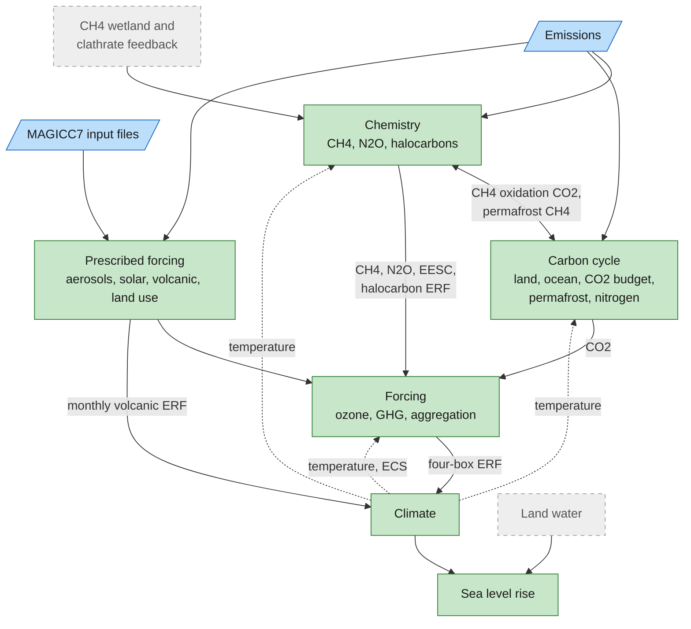

# MAGICC Module Documentation

MAGICC (Model for the Assessment of Greenhouse Gas Induced Climate Change) is a chain of scientific modules.
RSCM ports each one to a component.
This page records how far each port has got, the evidence of parity with MAGICC7, and the known gaps.
A dependency graph shows how the modules connect.
Each module also has its own page describing the MAGICC7 Fortran.

To run the ported chain, see [MAGICC runs](../magicc_runs.md).

## RSCM Implementation Status

Status levels:

- **Implemented**: the component follows the MAGICC7 module,
  and a regression test checks it against MAGICC7 v7.5.3 output.
- **Partial**: a component exists but simplifies the MAGICC7 physics and has no MAGICC7 parity test.

Rust components live in `crates/rscm-magicc/src/`, and source paths below are relative to it.
Each component has a Python builder in `rscm.magicc`, typed in `python/rscm/_lib/magicc.pyi`.
Parity tests are in `tests/regression/test_full_run.py` unless the row names another file.
They compare with MAGICC7's full-precision binary output at a relative tolerance of 1e-9
(absolute 1e-12), set in `tests/regression/full_run.py`.

| Module                                                    | Status      | RSCM component                                                                      | Source                                                     | MAGICC7 parity evidence                                                                                                                                                                                    | Issue                                                 |
| --------------------------------------------------------- | ----------- | ----------------------------------------------------------------------------------- | ---------------------------------------------------------- | ---------------------------------------------------------------------------------------------------------------------------------------------------------------------------------------------------------- | ----------------------------------------------------- |
| [Initialisation](module_00_initialisation.md)             | Implemented | `ModelBuilder`, LAMCALC inside `ClimateUDEB`, `natural_emissions`                   | `climate/lamcalc.rs`, `python/rscm/magicc/full.py`         | Every coupled run starts from it. `tests/test_magicc_full.py` checks that the natural emissions close the CH4 and N2O budgets                                                                              | -                                                     |
| [CH4 Chemistry](module_01_ch4_chemistry.md)               | Implemented | `CH4Chemistry`                                                                      | `chemistry/ch4.rs`                                         | `test_coupled_run` and `test_default_run`: CH4 concentration                                                                                                                                               | [#109](https://github.com/lewisjared/rscm/issues/109) |
| [CH4 oxidation to CO2](module_01_ch4_chemistry.md)        | Implemented | `CH4Oxidation`                                                                      | `chemistry/ch4_oxidation.rs`                               | `test_coupled_run`: CO2 concentration                                                                                                                                                                      | [#109](https://github.com/lewisjared/rscm/issues/109) |
| [N2O Chemistry](module_02_n2o_chemistry.md)               | Implemented | `N2OChemistry`                                                                      | `chemistry/n2o.rs`                                         | `test_coupled_run` and `test_default_run`: N2O concentration                                                                                                                                               | [#109](https://github.com/lewisjared/rscm/issues/109) |
| [Halocarbon Chemistry](module_03_halocarbon_chemistry.md) | Implemented | `HalocarbonChemistry`                                                               | `chemistry/halocarbon.rs`                                  | `test_halocarbons`: 41 concentrations, F-gas and Montreal Protocol ERF, and EESC. `test_default_run`: every concentration                                                                                  | [#109](https://github.com/lewisjared/rscm/issues/109) |
| [Ozone](module_04_ozone.md)                               | Implemented | `OzoneForcing`                                                                      | `forcing/ozone.rs`                                         | `test_ozone`: stratospheric, four-box tropospheric, N2O-induced and temperature-induced ozone ERF                                                                                                          | [#110](https://github.com/lewisjared/rscm/issues/110) |
| [Aerosol Direct](module_05_aerosol_direct.md)             | Implemented | `rscm.magicc.prescribed`: `direct_aerosol`, `nitrate`, `mineral_dust`, `bc_on_snow` | `python/rscm/magicc/prescribed.py`                         | `test_prescribed_forcing`: SOx, BC, OC and nitrate for each sector, mineral dust and BC on snow                                                                                                            | [#110](https://github.com/lewisjared/rscm/issues/110) |
| [Aerosol Indirect](module_06_aerosol_indirect.md)         | Implemented | `rscm.magicc.prescribed.cloud_albedo`                                               | `python/rscm/magicc/prescribed.py`                         | `test_prescribed_forcing[Aerosols\|Indirect Effect]`                                                                                                                                                       | [#110](https://github.com/lewisjared/rscm/issues/110) |
| Aerosols as Rust components                               | Partial     | `AerosolDirect`, `AerosolIndirect`                                                  | `forcing/aerosol_direct.rs`, `forcing/aerosol_indirect.rs` | None. Simplified, and the MAGICC models do not use them                                                                                                                                                    | [#110](https://github.com/lewisjared/rscm/issues/110) |
| [GHG Forcing](module_07a_ghg_forcing.md)                  | Implemented | `GHGForcing`                                                                        | `forcing/ghg.rs`                                           | `test_ch4_oxidation_strat_h2o`. `test_coupled_run`: total ERF with OLBL, and with IPCCTAR in `ipcctar`                                                                                                     | -                                                     |
| [RF Aggregation](module_07b_rf_aggregation.md)            | Implemented | `ForcingAggregation`                                                                | `forcing/aggregation.rs`                                   | `test_coupled_run`: total ERF and temperature, including `no_efficacy` and `prescribed_efficacy`                                                                                                           | [#114](https://github.com/lewisjared/rscm/issues/114) |
| [Climate](module_08_climate.md)                           | Implemented | `ClimateUDEB`                                                                       | `climate/udeb/`, `climate/lamcalc.rs`                      | `test_climate` from MAGICC7's own box forcing. `test_coupled_run` variants on equilibrium climate sensitivity, upwelling, diffusivity, ocean geometry, ground heat, interhemispheric exchange and feedback | [#108](https://github.com/lewisjared/rscm/issues/108) |
| [Terrestrial Carbon](module_09_terrestrial_carbon.md)     | Implemented | `TerrestrialCarbon`                                                                 | `carbon/terrestrial.rs`                                    | `test_coupled_run`: CO2, including `gifford_fertilisation`, `respiration_fertscale` and `no_carbon_temperature_feedback`                                                                                   | [#109](https://github.com/lewisjared/rscm/issues/109) |
| [Ocean Carbon](module_10_ocean_carbon.md)                 | Implemented | `OceanCarbon`                                                                       | `carbon/ocean.rs`                                          | `test_coupled_run`: CO2 concentration                                                                                                                                                                      | [#109](https://github.com/lewisjared/rscm/issues/109) |
| [CO2 Budget](module_11_co2_budget.md)                     | Implemented | `CO2Budget`                                                                         | `carbon/budget.rs`                                         | `test_coupled_run`: CO2 from emissions. `test_default_run`: CO2 prescribed up to 2015                                                                                                                      | [#109](https://github.com/lewisjared/rscm/issues/109) |
| [Permafrost](module_12_permafrost.md)                     | Implemented | `Permafrost`                                                                        | `carbon/permafrost.rs`                                     | `test_permafrost`: thawed area and CO2 and CH4 emissions. `test_coupled_run[permafrost]`                                                                                                                   | [#115](https://github.com/lewisjared/rscm/issues/115) |
| [Nitrogen Limitation](module_13_nitrogen_limitation.md)   | Implemented | `TerrestrialCarbon` with `nitrogen`                                                 | `carbon/nitrogen.rs`                                       | `test_nitrogen_coupled_run`: limitation factor, nitrogen pool and NPP at relative 1e-4 (MAGICC7 writes them only as text), temperature and concentrations at 1e-9                                          | [#116](https://github.com/lewisjared/rscm/issues/116) |
| [Sea Level Rise](module_14_sea_level_rise.md)             | Implemented | `SeaLevelRise`, thermal expansion in `ClimateUDEB`                                  | `climate/sea_level.rs`, `climate/udeb/`                    | `tests/regression/test_sea_level.py::test_contribution`: each contribution and the total                                                                                                                   | [#117](https://github.com/lewisjared/rscm/issues/117) |
| [Main Step](module_15_main_step.md)                       | Implemented | `emissions_driven`, `concentration_driven`                                          | `python/rscm/magicc/model.py`                              | `test_default_run` and `test_concentration_driven_run`: temperature, every concentration and total ERF                                                                                                     | [#105](https://github.com/lewisjared/rscm/issues/105) |
| Volcanic and solar forcing                                | Implemented | `rscm.magicc.prescribed`: `solar`, `volcanic_pattern`, `volcanic_substeps`          | `python/rscm/magicc/prescribed.py`, `climate/udeb/`        | `test_prescribed_forcing[Solar]`. Volcanic through `test_coupled_run` temperature. `tests/test_magicc_prescribed.py` checks the volcanic pattern                                                           | [#106](https://github.com/lewisjared/rscm/issues/106) |
| Land-use albedo forcing                                   | Implemented | `rscm.magicc.prescribed.land_use`                                                   | `python/rscm/magicc/prescribed.py`                         | `test_prescribed_forcing[Land-use Change]`                                                                                                                                                                 | [#107](https://github.com/lewisjared/rscm/issues/107) |

MAGICC7 calculates the historical aerosol, land-use, solar and volcanic forcing before the run
from its input files and emissions.
`rscm.magicc.prescribed` reproduces those calculations in Python and `ForcingAggregation`
combines them with the calculated agents.
Nitrate is split between the fossil and biosphere sectors by each source's NOx times NH3 emissions.
Monthly volcanic forcing enters `ClimateUDEB` through its `subannual_forcing` parameter.

### Coupled runs

Two Python models chain the components.
See [MAGICC runs](../magicc_runs.md) for usage.

- `rscm.magicc.emissions_driven` couples every component above except the Rust aerosol components.
  `Permafrost` and `SeaLevelRise` are optional.
- `rscm.magicc.concentration_driven` has the same components,
  with every concentration prescribed for the whole run.

`rscm.magicc.full.from_magicc7` translates MAGICC7's configuration into theirs.
`pf_apply` adds `Permafrost`, `ncycle_apply` nitrogen limitation and `out_sealevel` `SeaLevelRise`.
Like MAGICC7, it prescribes concentrations up to 2015
and the emissions-driven model calculates them from emissions afterwards.
`tests/regression/test_full_run.py` holds both models to MAGICC7 v7.5.3 at a relative tolerance of 1e-9,
and most cases agree to the last bit.
[Agreement with MAGICC7](../magicc_runs.md#agreement-with-magicc7)
lists the cases and the measured differences.

### Known gaps

Most come from the "Differences from MAGICC7" notes in each component's Rust documentation.

- **Initialisation**: CH4 and N2O natural emissions are fixed component parameters.
  `rscm.magicc.full.natural_emissions` calculates MAGICC7's budget-closing values,
  and `from_magicc7` uses them.
- **CH4 Chemistry**: no wetland or clathrate feedback.
- **Ozone**: aviation NOx is not separated from other NOx.
- **Aerosols**: the Rust `AerosolDirect` and `AerosolIndirect` components are simplified and unused.
  `AerosolIndirect` outputs only a global forcing.
- **Climate**: no El Niño or AMV modes.
  The last year runs 12 substeps where MAGICC7 runs 11.
  See [time conventions](time_conventions.md).
- **Terrestrial Carbon**: `from_magicc7` supports only `co2_plantboxresp_method` 2.
- **Ocean Carbon**: no BOXDIFF IRF, radiative-only switch, biological pump or circulation change.
- **CO2 Budget**: no concentration cap, no inverse fossil emissions while CO2 is prescribed,
  and no zero-emissions switch (`CO2_ZEROEMIS_AFTERXPGC_APPLY`).
- **Sea Level Rise**: no land water, semi-empirical method, FETTWEIS or DECONTO alternatives,
  or anomalies to 1986 to 2005.

## Module Dependency Graph

The graph shows how the module groups connect.
Solid arrows carry values within a step.
Dashed arrows are lagged edges, as in MAGICC7:
chemistry, the carbon cycle, permafrost and ozone forcing use the temperature at the start of each year,
and the forcing aggregation uses that year's equilibrium climate sensitivity.
Green groups are implemented and grey dashed modules are not.

Within the groups:

- `CH4Chemistry` sets the OH lifetime that `CH4Oxidation` and `HalocarbonChemistry` use.
- `Permafrost`, `TerrestrialCarbon` and `CH4Oxidation` feed `OceanCarbon` and `CO2Budget`.
  `CO2Budget` closes the balance, and its CO2 reaches the land and ocean at the start of the next year.
- `GHGForcing`, `OzoneForcing`, the halocarbon forcing and the prescribed forcing
  meet in `ForcingAggregation`.

The Rust aerosol components are left out because no runner uses them.
The [coupled MAGICC model](../notebooks/magicc_coupled_model.py) tutorial draws every coupling
between the components from the model RSCM builds.

## Time and space

Values are labelled with the start of the year they describe.
A state labelled 1751 is its value on 1 January 1751, after the step from 1750.
[ClimateUDEB time conventions](time_conventions.md) describe the monthly substeps within each step.

MAGICC has four boxes: northern ocean, northern land, southern ocean and southern land.
RSCM's `FourBox` grid uses the same boxes in that order.

## MAGICC7 Fortran structure

The module pages follow the Fortran.
This table lists where each module lives and how it iterates within a step.

| Module                                                    | Fortran file               | Purpose                                       | Iteration                                  |
| --------------------------------------------------------- | -------------------------- | --------------------------------------------- | ------------------------------------------ |
| [Initialisation](module_00_initialisation.md)             | `MAGICC7.f90`              | Datastore, geography and parameters           | LAMCALC secant or bisection, at start only |
| [CH4 Chemistry](module_01_ch4_chemistry.md)               | `methane.f90`              | CH4 concentration with OH feedback            | 4 Prather iterations                       |
| [N2O Chemistry](module_02_n2o_chemistry.md)               | `n2o.f90`                  | N2O concentration with stratospheric delay    | 4 fixed-point iterations                   |
| [Halocarbon Chemistry](module_03_halocarbon_chemistry.md) | `deltaq_calculations.f90`  | About 41 species with exponential decay       | None                                       |
| [Ozone](module_04_ozone.md)                               | `deltaq_calculations.f90`  | Tropospheric and stratospheric ozone          | None                                       |
| [Aerosol Direct](module_05_aerosol_direct.md)             | `radiative_forcing.f90`    | BC, OC, SOx, dust and nitrate                 | None                                       |
| [Aerosol Indirect](module_06_aerosol_indirect.md)         | `cloudstore.f90`           | Cloud albedo                                  | None                                       |
| [GHG Forcing](module_07a_ghg_forcing.md)                  | `deltaq_calculations.f90`  | CO2, CH4 and N2O forcing, IPCCTAR or OLBL     | None                                       |
| [RF Aggregation](module_07b_rf_aggregation.md)            | `deltaq_calculations.f90`  | Sums forcing agents and applies efficacies    | None                                       |
| [Climate](module_08_climate.md)                           | `climate_and_ocean.f90`    | Energy balance and ocean heat uptake          | 12 monthly substeps                        |
| [Terrestrial Carbon](module_09_terrestrial_carbon.md)     | `carbon_cycle.f90`         | Three-pool land carbon                        | None                                       |
| [Ocean Carbon](module_10_ocean_carbon.md)                 | `carbon_cycle_ocean/*.f90` | Ocean CO2 uptake from impulse response models | 12 monthly substeps                        |
| [CO2 Budget](module_11_co2_budget.md)                     | `MAGICC7.f90`              | Atmospheric carbon mass balance               | None                                       |
| [Permafrost](module_12_permafrost.md)                     | `permafrost.f90`           | Thaw-driven CH4 and CO2 release               |                                            |
| [Nitrogen Limitation](module_13_nitrogen_limitation.md)   | `nitrogen_limitation.f90`  | Nitrogen constraint on NPP                    | Bisection, about 20 iterations             |
| [Sea Level Rise](module_14_sea_level_rise.md)             | `sealevel.f90`             | Thermal expansion, glaciers and ice sheets    |                                            |
| [Main Step](module_15_main_step.md)                       | `MAGICC7.f90`              | Orchestrates the annual steps                 |                                            |

Each module page covers the module's scientific purpose, equations, state variables, parameters,
inputs and outputs, algorithm, Fortran references, numerical considerations and test cases.
