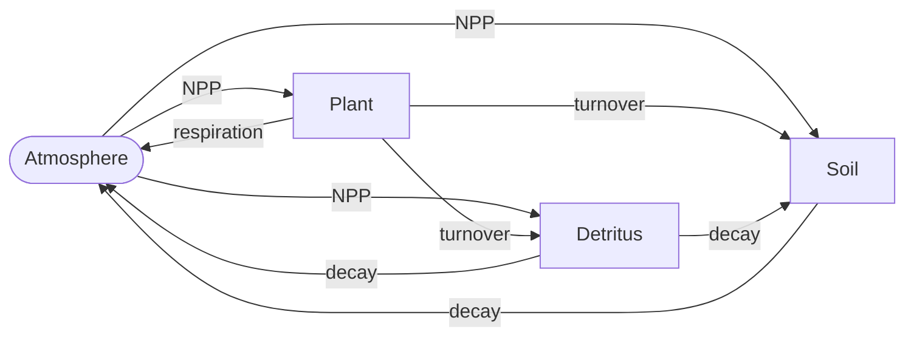

# Module 09: Terrestrial Carbon Cycle

## Overview

The terrestrial carbon cycle exchanges carbon between the atmosphere and three land pools:

- **Plant**: living vegetation (leaves, stems, roots).
- **Detritus**: litter and other dead organic matter in transition.
- **Soil**: long-lived organic carbon.

The atmosphere is not a pool here. It enters through the net flux.
Two feedbacks shape the land sink:

- **CO2 fertilisation**: higher CO2 raises net primary production (NPP),
  which slows the rise in atmospheric CO2.
- **Temperature**: warming changes NPP, plant respiration and the decay of detritus and soil carbon.

The module also handles land-use emissions (deforestation) and the regrowth that follows them.
It carries a second set of "no-feedback" pools to keep land-use emissions separate from the feedbacks.

## RSCM implementation

- **Component**: `TerrestrialCarbon`, built in Python with `rscm.magicc.TerrestrialCarbonBuilder`.
- **Source**: `crates/rscm-magicc/src/carbon/terrestrial.rs`,
  parameters in `crates/rscm-magicc/src/parameters/terrestrial_carbon.rs`.
- **Status**: Implemented. See the [status table](README.md#rscm-implementation-status).
- **Tests**: `tests/regression/test_full_run.py::test_coupled_run` checks CO2 against MAGICC7 v7.5.3,
  including the `gifford_fertilisation`, `respiration_fertscale`
  and `no_carbon_temperature_feedback` variants.
  Rust tests are in `crates/rscm-magicc/tests/carbon_cycle_physics.rs` and `conservation.rs`.

Nitrogen limitation of NPP ([module 13](module_13_nitrogen_limitation.md)) is part of the same component,
switched on by its `nitrogen` parameters.

## Equations

### Pools and fluxes

NPP is split between the pools by the fractions $f_P$, $f_D$ and $f_S = 1 - f_P - f_D$.
Deforestation removes carbon from each pool as well (see [land-use change](#land-use-change-and-regrowth)).

### Temperature factors

Each feedback multiplies a rate by

$$
f_T^X = \exp(\gamma_X \, \Delta T)
$$

where $X$ is NPP, plant respiration, detritus decay or soil decay,
and $\Delta T$ is the warming since `CO2_TEMPFEEDBACK_YRSTART`, floored at zero (zero before that year).
The [temperature feedback parameters](#temperature-feedback-parameters) give the sign convention.

### Net primary production

$$
NPP(t) = NPP_0 \, \beta(CO_2) \, f_T^{NPP}
$$

where $NPP_0$ is `CO2_NPP_INITIAL` and $\beta$ is the CO2 fertilisation factor.
With nitrogen limitation, NPP is then multiplied by the
[limitation factor](module_13_nitrogen_limitation.md#nitrogen-limitation-factor).

### CO2 fertilisation

The factor compares the mid-year CO2 concentration $CO_2$ with a reference $CO_{2,ref}$
(see the [algorithm](#algorithm) for both).
Three forms exist, with $\beta_0$ = `CO2_FERTILIZATION_FACTOR`.

Logarithmic (Keeling and Bacastow):

$$
\beta_{log} = 1 + \beta_0 \ln\left(\frac{CO_2}{CO_{2,ref}}\right)
$$

Rectangular hyperbolic (Gifford, Michaelis-Menten form, Wigley 1993 equations A2 and A5):

$$
\beta_{Gif} = \frac{1/C_r + B_{ee}}{1/D_r + B_{ee}},
\qquad
B_{ee} = \frac{A_r/B_r - R}{(R - 1)\,A_r}
$$

with $C_r = CO_{2,ref} - CO_{2,zero}$, $D_r = CO_2 - CO_{2,zero}$,
$A_r = 680 - CO_{2,zero}$, $B_r = 340 - CO_{2,zero}$ and
$R = \dfrac{1 + \beta_0 \ln(680/CO_{2,ref})}{1 + \beta_0 \ln(340/CO_{2,ref})}$.
$CO_{2,zero}$ is `CO2_GIFFORD_CONC_FOR_ZERONPP`, the concentration at which NPP is zero.
$B_{ee}$ makes the Gifford form match the logarithmic one at 340 and 680 ppm.

Saturating sigmoid (A. Norton):

$$
\beta_{sig} = \frac{\beta_0}{1 + \exp\left(-(CO_2 - CO_{2,ref,sig})/B\right)},
\qquad
CO_{2,ref,sig} = CO_{2,ref} + B \ln(\beta_0 - 1)
$$

where $B$ is `CO2_FERTILIZATION_FACTOR2`, so that $\beta_{sig} = 1$ at the reference.

`CO2_FERTILIZATION_METHOD` ($m$) blends neighbouring forms linearly:

$$
\beta =
\begin{cases}
1 & m < 1 \\
(2 - m)\,\beta_{log} + (m - 1)\,\beta_{Gif} & 1 \le m \le 2 \\
(3 - m)\,\beta_{Gif} + (m - 2)\,\beta_{sig} & 2 < m \le 3
\end{cases}
$$

The default $m = 1.100486$ is mostly logarithmic.

### Plant respiration

`CO2_PLANTBOXRESP_METHOD` selects the respiration flux from the plant pool.
Method 1 scales with the full fertilisation factor:

$$
R_h = R_{h,0} \, \beta \, f_T^{resp}
$$

Method 2, the MAGICC7 default, damps the fertilisation effect and scales with the plant pool:

$$
R_h = R_{h,0} \left(1 + \alpha_{resp}(\beta - 1)\right) \min\left(1, \frac{C_P}{C_{P,0}}\right) f_T^{resp}
$$

where $R_{h,0}$ is `CO2_RESPIRATION_INITIAL` and $\alpha_{resp}$ is `CO2_PLANTBOXRESP_FERTSCALE`.

### Pool updates

Each pool $C_X$ with input flux $F_X$ and decay rate $k_X$ is advanced one year
by the implicit trapezoidal (Crank-Nicolson) step

$$
C_X(t+1) = \frac{C_X(t)\left(1 - \tfrac{1}{2}k_X\right) + F_X}{1 + \tfrac{1}{2}k_X}
$$

and the outgoing turnover flux is $k_X \tfrac{1}{2}\left(C_X(t) + C_X(t+1)\right)$.
The decay rates and input fluxes are:

| Pool     | Decay rate $k_X$               | Input flux $F_X$                                                                         |
| -------- | ------------------------------ | ---------------------------------------------------------------------------------------- |
| Plant    | $1/\tau_P$                     | $f_P \, NPP - R_h - E_{gross,P}$                                                         |
| Detritus | $f_T^{detr}/\tau_D$            | $f_D \, NPP + f_{P2D} \, T_P - E_{gross,D}$                                              |
| Soil     | $f_T^{soil}/\tau_S$            | $f_S \, NPP + (1 - f_{P2D}) \, T_P + f_{D2S} \, T_D - E_{gross,S}$                       |

$T_P$ and $T_D$ are the plant and detritus turnover fluxes,
$f_{P2D}$ is `CO2_FRACTION_PLANT_2_DETRITUS` and $f_{D2S}$ is `CO2_FRACTION_DETRITUS_2_SOIL`.
The rest of the detritus decay, $(1 - f_{D2S})\,T_D$, and all soil decay return to the atmosphere.

### Turnover times

The pre-industrial turnover times follow from a steady state at the initial pools:

$$
\tau_{P,0} = \frac{C_{P,0}}{f_P \, NPP_0 - R_{h,0}},
\qquad
\tau_{D,0} = \frac{C_{D,0}}{f_D \, NPP_0 + f_{P2D}\,(f_P \, NPP_0 - R_{h,0})}
$$

$$
\tau_{S,0} = \frac{C_{S,0}}{NPP_0 - R_{h,0} - (1 - f_{D2S})\,C_{D,0}/\tau_{D,0}}
$$

Permanent deforestation shortens them.
With cumulative land-use emissions $\Sigma E$ up to and including this year,
$f_{nr}$ = `CO2_NORGRWTH_FRAC_DEFO` and $f_{defo,X}$ the share of deforestation from pool $X$:

$$
\tau_X(t) = \frac{C_{X,0} - f_{nr} \, f_{defo,X} \, \Sigma E}{F_{X,0}}
$$

$F_{X,0}$ is the denominator of $\tau_{X,0}$.
For the soil pool it is re-evaluated with the reduced detritus pool $C_{D,0} - f_{nr} f_{defo,D} \Sigma E$
and the current $\tau_D(t)$.

### Land-use change and regrowth

Net land-use emissions $E_{CO2B}$ are split between the pools:
$E_{net,X} = f_{defo,X} \, E_{CO2B}$, with $f_{defo,P}$ = `CO2_FRACTION_DEFOREST_PLANT`,
$f_{defo,D}$ = `CO2_FRACTION_DEFOREST_DETRITUS` and $f_{defo,S} = 1 - f_{defo,P} - f_{defo,D}$.
Gross deforestation adds the regrowth sink $G_X$:

$$
E_{gross,X} = E_{net,X} + G_X
$$

Regrowth comes from the no-feedback pools $C_X^{nf}$, which use the same update without fertilisation,
temperature factors or nitrogen limitation.
Their input $F_X^{nf}$ uses $NPP_0$ and $R_{h,0}$.
Algebraically, regrowth is the no-feedback input in excess of the no-feedback turnover:

$$
G_X(t) = F_X^{nf} - C_X^{nf}(t)/\tau_X(t)
$$

MAGICC7 reaches this value through a preliminary no-feedback step
with net deforestation and last year's regrowth.
RSCM repeats that order of operations.

### Mass conservation correction

The no-feedback pools should lose exactly the land-use emissions.
The residual

$$
\Delta_{corr} = E_{CO2B} + \sum_X \left(C_X^{nf}(t+1) - C_X^{nf}(t)\right)
$$

is subtracted from both the plant pool and the no-feedback plant pool.

## Inputs and outputs

| Input                       | RSCM variable                   | Units  | Fortran variable                       |
| --------------------------- | ------------------------------- | ------ | -------------------------------------- |
| CO2 concentration           | `Atmospheric Concentration|CO2` | ppm    | `DAT_CO2_CONC`                         |
| Feedback temperature        | `Surface Temperature`           | K      | `FEEDBACK_TEMPERATURE` (argument)      |
| Land-use CO2 emissions      | `Emissions|CO2|Land Use`       | GtC/yr | `DAT_CO2B_EMIS`, `DAT_CO2B_CUMEMIS`    |
| Nitrogen limitation factor  | (internal, with `nitrogen`)     | 1      | `NCYCLE_LIMIT_FACTOR`                  |

| Output or state             | RSCM variable                          | Units  | Fortran variable                  |
| --------------------------- | -------------------------------------- | ------ | --------------------------------- |
| Plant, detritus, soil pools | `Carbon Pool|Plant`, `Carbon Pool|Detritus`, `Carbon Pool|Soil` | GtC    | `CO2_PLANT_POOL`, `CO2_DETRITUS_POOL`, `CO2_SOIL_POOL` |
| Net land uptake             | `Carbon Flux|Terrestrial`              | GtC/yr | `CO2_DELTA_TERRPOOLS`             |
| Gross deforestation         | `Emissions|CO2|Gross Deforestation`    | GtC/yr | `CO2_GROSSDEFO_EMIS`              |
| Regrowth                    | `Carbon Flux|Regrowth`                 | GtC/yr | `CO2_REGROWTH_TOTAL_FLUX`         |
| NPP                         | `Net Primary Production`               | GtC/yr | `CO2_CURRENT_NPP`                 |
| Total respiration           | `Respiration|Terrestrial`              | GtC/yr | `CO2_TOTALRESPIRATION`            |

MAGICC7 also stores the no-feedback pools (`CO2_NOFEED_*_POOL`), the regrowth per pool,
the effective factors (`CO2_EFF_FERTILIZATION_FACTOR`, `CO2_EFF_*_TEMPFEEDBACK`)
and the current turnover times.
After `TERRCARBON2` returns, `MAGICC7.f90` derives `CO2_AIR2LAND_FLUX`, `CO2_NETECOEXCH_FLUX`,
`CO2_LAND_POOL` and `CO2_NETATMOSLANDCO2FLUX` from the pools.

## Parameters

Defaults are MAGICC7 v7.5.3's `MAGCFG_DEFAULTALL.CFG`, which the RSCM defaults match.

### Initial pools and fluxes

| Parameter                  | Units  | Default  | Description                                  |
| -------------------------- | ------ | -------- | -------------------------------------------- |
| `CO2_PLANTPOOL_INITIAL`    | GtC    | 884.8584 | Pre-industrial plant pool $C_{P,0}$          |
| `CO2_DETRITUSPOOL_INITIAL` | GtC    | 92.7738  | Pre-industrial detritus pool $C_{D,0}$       |
| `CO2_SOILPOOL_INITIAL`     | GtC    | 1681.525 | Pre-industrial soil pool $C_{S,0}$           |
| `CO2_NPP_INITIAL`          | GtC/yr | 66.2716  | Pre-industrial NPP $NPP_0$                   |
| `CO2_RESPIRATION_INITIAL`  | GtC/yr | 12.26025 | Pre-industrial plant respiration $R_{h,0}$   |

### CO2 fertilisation parameters

| Parameter                      | Units | Default   | Description                                            |
| ------------------------------ | ----- | --------- | ------------------------------------------------------ |
| `CO2_FERTILIZATION_FACTOR`     | 1     | 0.6485981 | $\beta_0$                                              |
| `CO2_FERTILIZATION_FACTOR2`    | ppm   | 100.0     | Sigmoid curvature $B$                                  |
| `CO2_FERTILIZATION_METHOD`     | 1     | 1.100486  | Blend: below 1 none, 1 log, 2 Gifford, 3 sigmoid       |
| `CO2_FERTILIZATION_YRSTART`    | year  | 1900      | Year from which the CO2 reference stops rising         |
| `CO2_GIFFORD_CONC_FOR_ZERONPP` | ppm   | 80.0      | $CO_{2,zero}$, Gifford only                            |
| `CO2_PREINDCO2CONC`            | ppm   | 278.0     | Pre-industrial CO2                                     |

### Temperature feedback parameters

| Parameter                        | Units | Default    | Rate it scales                  |
| -------------------------------- | ----- | ---------- | ------------------------------- |
| `CO2_TEMPFEEDBACK_SWITCH`        | flag  | 1          | 0 turns all four factors off    |
| `CO2_TEMPFEEDBACK_YRSTART`       | year  | 1900       | Reference year for $\Delta T$   |
| `CO2_FEEDBACKFACTOR_NPP`         | K⁻¹   | 0.01070037 | NPP ($\gamma_{NPP}$)            |
| `CO2_FEEDBACKFACTOR_RESPIRATION` | K⁻¹   | 0.06845893 | Plant respiration ($\gamma_{resp}$) |
| `CO2_FEEDBACKFACTOR_DETRITUS`    | K⁻¹   | -0.1357817 | Detritus decay rate ($\gamma_D$) |
| `CO2_FEEDBACKFACTOR_SOIL`        | K⁻¹   | 0.1540879  | Soil decay rate ($\gamma_S$)    |
| `CO2_FEEDTEMP_LANDONLY_APPLY`    | flag  | 0          | 1 uses land instead of global-mean temperature |

All four factors follow one sign convention: a positive $\gamma$ makes its rate rise with warming.
For detritus and soil the rate is the decay rate $1/\tau$, so a positive $\gamma$ releases carbon faster.
The default $\gamma_D$ is negative, so warming slows detritus decay while it speeds up soil decay.
This is MAGICC7's calibrated value, and the code applies it without a sign change.

### Carbon flow fractions

| Parameter                       | Default    | Description                                         |
| ------------------------------- | ---------- | --------------------------------------------------- |
| `CO2_FRACTION_NPP_2_PLANT`      | 0.4482615  | $f_P$, share of NPP to the plant pool               |
| `CO2_FRACTION_NPP_2_DETRITUS`   | 0.3998165  | $f_D$, share of NPP to the detritus pool            |
| `CO2_FRACTION_PLANT_2_DETRITUS` | 0.9989021  | $f_{P2D}$, share of plant turnover to detritus      |
| `CO2_FRACTION_DETRITUS_2_SOIL`  | 0.00100763 | $f_{D2S}$, share of detritus decay to soil          |

The soil share of NPP, $f_S = 1 - f_P - f_D$, is derived.

### Deforestation and respiration parameters

| Parameter                        | Default | Description                                               |
| -------------------------------- | ------- | --------------------------------------------------------- |
| `CO2_FRACTION_DEFOREST_PLANT`    | 0.7     | $f_{defo,P}$                                              |
| `CO2_FRACTION_DEFOREST_DETRITUS` | 0.05    | $f_{defo,D}$ ($f_{defo,S}$ is the remainder)              |
| `CO2_NORGRWTH_FRAC_DEFO`         | 0.5     | $f_{nr}$, share of deforestation that does not regrow     |
| `CO2_PLANTBOXRESP_METHOD`        | 2       | [Plant respiration](#plant-respiration) method            |
| `CO2_PLANTBOXRESP_FERTSCALE`     | 0.95    | $\alpha_{resp}$, method 2 only                            |

`GTC_PER_PPM` (2.123 GtC/ppm) is set in `carboncycle_init` rather than read from the configuration.

## Algorithm

`TERRCARBON2` runs once per year, called from `MAGICC7.f90`.
Steps that only evaluate an equation above are named, not repeated.

1. Extrapolate CO2 to mid-year from the last three annual values:
   $CO_2 = \left(3\,CO_2(t-2) - 10\,CO_2(t-1) + 15\,CO_2(t)\right)/8$.
   The indices are floored at the first year.
2. Set the fertilisation reference.
   Before `CO2_FERTILIZATION_YRSTART`, $CO_{2,ref}$ and its ceiling both follow the extrapolated CO2.
   From that year on the ceiling is frozen and $CO_{2,ref} = \min(\text{ceiling}, CO_2)$,
   so the reference can fall but not rise.
3. Evaluate the [temperature factors](#temperature-factors)
   and the [fertilisation factor](#co2-fertilisation).
4. Update the [turnover times](#turnover-times) with this year's cumulative land-use emissions.
5. Evaluate [NPP](#net-primary-production) and [plant respiration](#plant-respiration).
6. With `NCYCLE_APPLY`, call `N_CALC_LIMITATION_FACTOR` with the unlimited NPP
   and multiply NPP by the factor ([module 13](module_13_nitrogen_limitation.md#algorithm)).
7. Update the pools in the order plant, detritus, soil,
   because detritus and soil use the turnover fluxes of the pools before them.
   For each pool:
    1. Compute the regrowth $G_X$ from the no-feedback pool.
    2. Advance the no-feedback pool with gross deforestation $E_{gross,X}$.
    3. Advance the pool itself with its feedback-modified decay rate and input flux.
       The plant pool is floored at zero.
8. Apply the [mass conservation correction](#mass-conservation-correction).
9. Write the aggregates:
    - $\Delta C$ = `CO2_DELTA_TERRPOOLS`, the change in the three pools.
    - `CO2_TERRBIO_AND_FOSSIL_EMIS` = fossil emissions $- \Delta C$, plus permafrost CO2 with `PF_APPLY`.
      [Module 11](module_11_co2_budget.md) turns this into the atmospheric CO2 change.
    - Total respiration = $NPP - \Delta C - \sum_X E_{gross,X}$, so it absorbs the correction.
    - Cumulative net emissions, gross deforestation and total regrowth.

## Numerical considerations

- The trapezoidal step is unconditionally stable for linear decay and second-order in time.
  It is applied once per year with no iteration.
- The step assumes a one-year timestep. RSCM rejects any other.
- If cumulative deforestation approaches a pool's initial size, its turnover time tends to zero.
- The logarithmic factor falls below one when CO2 drops below the reference,
  and the Gifford form is singular near $CO_{2,zero}$.
- In `carboncycle_init`, negative derived fractions are renormalised,
  `CO2_FRACTION_PLANT_2_DETRITUS` is capped at 1,
  and `CO2_RESPIRATION_INITIAL` is cut to $0.99 \, f_P \, NPP_0$ if needed to keep $\tau_{P,0}$ positive.

## Issues in MAGICC7

- `TERRCARBON2` lives in `MAGICC7.f90` (lines 7054 to 7542).
  `carbon_cycle.f90` holds only declarations and `carboncycle_init`,
  and opens with `! TODO: refactor in carbon cycle functions`.
- Only the plant pool is floored at zero. Detritus and soil can go negative under extreme scenarios.
- No warning is raised if the mass conservation correction grows large.
- `CO2_TOTALDEAD_POOL` is allocated but only zeroed.
- The regrowth code computes a quantity that reduces to one line of algebra,
  which makes it hard to check by reading.
- Variable names abbreviate inconsistently, for example `CURNTFLUX_DETRITUS2SOILATMOS`,
  `CURR_TURNOVERT_DETRPOOL` and `INI_TURNOVERTIME_DETRPOOL`.
- The code cites no literature for the fertilisation or feedback forms.
- Hardcoded values:

| Value                 | Location                   | Use                                    |
| --------------------- | -------------------------- | -------------------------------------- |
| 2.123                 | `carbon_cycle.f90:88`      | `GTC_PER_PPM`                          |
| 0.99                  | `carbon_cycle.f90:120`     | Respiration guard                      |
| 340, 680              | `MAGICC7.f90:7203-7204`    | Gifford matching concentrations        |
| 3, 10, 15, 8          | `MAGICC7.f90:7103-7105`    | Mid-year CO2 extrapolation             |

## Differences from MAGICC7

- Only respiration method 2 exists.
  `run_magicc7` raises `ValueError` for any other `co2_plantboxresp_method`.
- `CO2_FEEDTEMP_LANDONLY_APPLY` is not supported. The feedbacks use `Surface Temperature`.
- `run_magicc7` maps `CO2_TEMPFEEDBACK_SWITCH = 0` to zero sensitivities.
- RSCM adds guards: the fertilisation factor is floored at 0.1, turnover times at one year,
  and all three pools at zero.
  The parity tests match MAGICC7 to 1e-9, so the guards do not bind in those runs.

## References

| Section                              | File                    | Lines           |
| ------------------------------------ | ----------------------- | --------------- |
| Declarations                         | `carbon_cycle.f90`      | 1-63            |
| `carboncycle_init`                   | `carbon_cycle.f90`      | 65-139          |
| Fraction normalisation               | `carbon_cycle.f90`      | 89-110          |
| Respiration guard                    | `carbon_cycle.f90`      | 119-124         |
| Initial turnover times               | `carbon_cycle.f90`      | 129-137         |
| `TERRCARBON2`                        | `MAGICC7.f90`           | 7054-7542       |
| Mid-year CO2 extrapolation           | `MAGICC7.f90`           | 7103-7105       |
| Fertilisation reference              | `MAGICC7.f90`           | 7111-7135       |
| Temperature factors                  | `MAGICC7.f90`           | 7141-7148       |
| Sigmoid, logarithmic, Gifford        | `MAGICC7.f90`           | 7179-7224       |
| Fertilisation blend                  | `MAGICC7.f90`           | 7232-7240       |
| Turnover times                       | `MAGICC7.f90`           | 7247-7265       |
| NPP and respiration                  | `MAGICC7.f90`           | 7270-7284       |
| Nitrogen limitation                  | `MAGICC7.f90`           | 7293-7300       |
| Plant, detritus, soil updates        | `MAGICC7.f90`           | 7357-7459       |
| Gross deforestation                  | `MAGICC7.f90`           | 7464-7465       |
| Pool change and total respiration    | `MAGICC7.f90`           | 7504-7530       |
| Call site                            | `MAGICC7.f90`           | 4820            |
| Feedback temperature                 | `MAGICC7.f90`           | 3826-3858       |
| Post-processing                      | `MAGICC7.f90`           | 5010-5075       |
| Namelist                             | `allcfgs.f90`           | 36-54           |
| Defaults                             | `MAGCFG_DEFAULTALL.CFG` | 49-80           |

- Meinshausen, M., Raper, S. C. B. and Wigley, T. M. L. (2011).
  Emulating coupled atmosphere-ocean and carbon cycle models with a simpler model, MAGICC6, Part 1:
  Model description and calibration. *Atmospheric Chemistry and Physics*, 11, 1417-1456.
- Wigley, T. M. L. (1993). Balancing the carbon budget: implications for projections of future
  carbon dioxide concentration changes. *Tellus B*, 45, 409-425.
