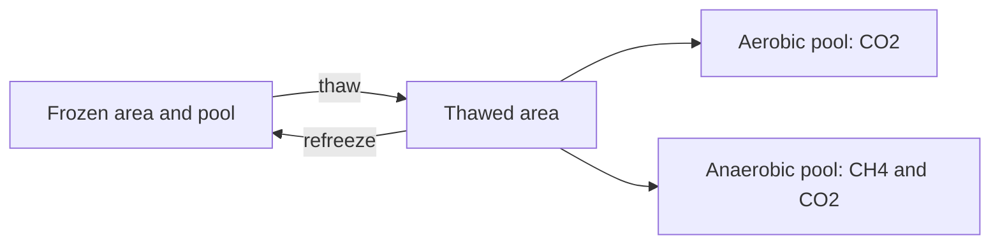

# Module 12: Permafrost Feedback

/// warning | Experimental in MAGICC7
MAGICC7 lists the permafrost module among its experimental components
(the comment is quoted on [module 14](module_14_sea_level_rise.md)).
Line 3 of `permafrost.f90` also warns that its header documentation is stale:
`! TODO: update this (all out of date/conflicting with MAGCFG_DEFAULTALL.CFG)`.
This page follows the code and `MAGCFG_DEFAULTALL.CFG`, not that header.
///

## Overview

The permafrost module releases carbon, as CO2 and CH4, from thawing permafrost soils as the Arctic warms.
Permafrost holds an estimated 800 to 1600 GtC of frozen organic matter.
Thawed carbon decomposes and returns to the atmosphere, which is a positive climate feedback.

The module represents:

- **Zonal bands**: the permafrost region is split into latitudinal bands (50 by default),
  each with its own thawing threshold.
- **Two soil types**: mineral soil (faster decomposition) and peat (slower, more anaerobic).
- **Two decomposition pathways**: aerobic decomposition produces CO2,
  and anaerobic decomposition produces CH4 through methanogenesis.
- **A seasonal soil temperature cycle**: summer maximum temperatures set the thaw rate,
  and the monthly cycle sets the decomposition rates.
- **Arctic amplification**: Arctic warming is a fixed multiple of global warming.

As global temperatures rise, Arctic summer temperatures exceed the melting threshold in more bands.
Their frozen carbon becomes available to decompose,
and the CO2 and CH4 released add to atmospheric concentrations.

## RSCM implementation

- **Component**: `Permafrost`, built from Python with `rscm.magicc.PermafrostBuilder`.
- **Source**: `crates/rscm-magicc/src/carbon/permafrost.rs`, parameters in `parameters/permafrost.rs`.
- **Status**: Implemented. See the [status table](README.md#rscm-implementation-status).
  `rscm.magicc.full.run_magicc7` adds it with `pf_apply`, which MAGICC7 sets to 1 by default.
- **Tests**: `tests/regression/test_full_run.py::test_permafrost` drives `Permafrost`
  with MAGICC7's full-precision temperature and matches its thawed area and CO2 and CH4 emissions bit for bit.
  `test_coupled_run[permafrost]` checks the coupled chain against MAGICC7's permafrost run.
  Unit tests in `permafrost.rs` cover conservation, refreezing and the thaw split.

The equations and algorithm below describe MAGICC7 v7.5.3 as RSCM reproduces it.
Several details differ from the module's own header documentation.
They were settled by comparing with MAGICC7 output and its disassembly.

## Equations

### Carbon pool structure

Each band holds a frozen and a thawed part of each soil type.
The thawed part is split into aerobic and anaerobic areas, each with a carbon pool:

This structure repeats for mineral soil (80 % of the carbon by default) and peat, in every band.

### Zonal pool distribution

Band $i$ ($i = 1 \dots N$, south to north) holds a fraction $f_{pool}(i)$ of the total pool `PF_TOT_POOL`.
For `PF_ZONAL_POOLDISTR` $d \le 0$ the carbon is skewed north:

$$
f_{pool}(i) = \frac{(1+d)/N - d\, i/N^2}{1 + d/2 - d/(2N)}
$$

For $d > 0$ the same triangle points the other way, with $-d$ in place of $d$ and $N + 1 - i$ in place of $i$.
$d = 0$ spreads the carbon equally.
The mineral soil share of each band is interpolated linearly
from `PF_MINSOIL_SOUTHERN_POOLFRACTION` to `PF_MINSOIL_NORTHERN_POOLFRACTION`,
and peat takes the rest.
These potential pools $P_{MS}(i)$ and $P_{PEAT}(i)$ start fully frozen.

### Arctic temperature and summer maximum

The summer maximum temperature of band $i$, relative to its melting threshold, is

$$
T_{sm}(t,i) = a\, \Delta T_{global}(t) - T_{melt}(i)
$$

where $a$ is `PF_ARCTIC_AMPLIFICATION` and the threshold is interpolated linearly across the bands:

$$
T_{melt}(i) = T_{melt,min} + \frac{i-1}{N-1} \left( T_{melt,max} - T_{melt,min} \right)
$$

$\Delta T_{global}(t)$ is the global mean surface temperature at the start of the year.

### Thaw and refreeze rate

$$
R(t,i) = \operatorname{sign}(T_{sm}) \, |T_{sm}|^{\alpha} \, R_{base}
$$

where $\alpha$ is `PF_x_THAWFREEZE_EXP_TEMP` and $R_{base}$ is `PF_x_THAWFREEZE_PERCPERK_RATE`
(fraction per K per year), with `x` either `MS` or `PEAT`.
A negative rate refreezes thawed area.
With the default $\alpha = 1$ the rate is linear in $T_{sm}$.

### Seasonal soil temperature

Month $m = 1 \dots 12$ has the soil temperature

$$
T_{soil}(m) = T_{sm} + \frac{A}{2} \left( \sin\frac{\pi (m-1)}{22} - 1 \right)
$$

where $A$ is `PF_TSOILANNUALCYCLE_AMPL`.
The argument runs from 0 to $\pi/2$, a quarter wave:
the temperature rises from $T_{sm} - A/2$ in month 1 to $T_{sm}$ in month 12.
MAGICC7 writes the argument as `(M - 1) * PI / 11` with `PI = ACOS(0.0D0)`, which holds $\pi/2$.

### Soil moisture

Soil moisture is linear in soil temperature, bounded below by $W_{min}$ and above by 1:

$$
W(m) = \min\left(1, \max\left(W_{min},\ M\, T_{soil}(m) + W_{offset}\right)\right)
$$

with $M$ = `PF_SOILWATER_M`, $W_{offset}$ = `PF_SOILWATER_OFFSET` and $W_{min}$ = `PF_SOILWATER_MINW`.
The moisture modifier is

$$
f_{moist}(m) = \frac{1 - e^{-W(m)}}{1 - e^{-1}}
$$

### Q10 temperature response

Decomposition follows the LPJ temperature response (Sitch et al. 2003):

$$
Q_{10}(m) = \exp\left( \alpha_Q \left( \frac{1}{T_1} - \frac{1}{T_{soil}(m) + T_2} \right) \right)
$$

with $\alpha_Q$ = `PF_Q10_x_y_ALPHA` for soil type `x` and pathway `y`,
$T_1$ = `PF_Q10_TEMP1` and $T_2$ = `PF_Q10_TEMP2`.

### Decomposition rates

The monthly rates are

$$
D_{aer}(m) = \frac{r_{soil}}{\tau} \, Q_{10,aer}(m) \, f_{moist}(m)
$$

$$
D_{an}(m) = \frac{r_{an}\, r_{soil}}{\tau} \, Q_{10,an}(m)
$$

where $\tau$ is `PF_MS_AEROB_DECOMP_TURNOVERTIME`, $r_{an}$ is `PF_DECOMPRATE_ANAEROB_OVER_AEROB_RATIO`,
and $r_{soil}$ is 1 for mineral soil and `PF_DECOMPRATE_PEAT_OVER_MS_RATIO` for peat.
Anaerobic decomposition has no moisture modifier.
The annual rates $D_{aer}$ and $D_{an}$ are the means of the 12 monthly rates.

### Aerobic and anaerobic area fractions

The anaerobic (water-saturated) fraction of the thawed area responds to moisture:

$$
f_{an}(m) = \max\left(0, \min\left(f_{max},\ f_{init} + (f_{max} - f_{init})\, f_{moist}(m)\, S\right)\right)
$$

with $f_{init}$ = `PF_x_ANAEROB_INITIAL_AREAFRACTION`, $f_{max}$ = `PF_x_ANAEROB_MAX_AREAFRACTION`
and $S$ = `PF_x_ANAEROB_MOISTSENS`.
The aerobic fraction of the year is $\phi(t) = 1 - \overline{f_{an}}$, the mean over the 12 months.
The default $S = 0$ holds the fractions at $f_{init}$.

### Area and carbon updates

Let $F$ be the frozen area and $A_{aer}$, $A_{an}$ the thawed areas before the step.
The existing thawed area $1 - F$ is first split with this year's fraction:
$\phi(t)(1 - F)$ aerobic and $(1 - \phi(t))(1 - F)$ anaerobic.
Area that changes type carries the carbon density of the type it leaves.

New thaw is a fraction of the remaining frozen area, split with the previous year's fraction $\phi(t-1)$:

$$
\Delta A_{aer} = \max\left(-A_{aer},\ \min\left(R\, \Delta t\, \phi(t-1)\, F,\ \phi(t-1)\, F\right)\right)
$$

and likewise $\Delta A_{an}$ with $1 - \phi(t-1)$ and $A_{an}$.
Thaw therefore never exceeds the frozen area,
and refreezing never exceeds each type's thawed area before the step.
Thawing moves carbon at the frozen pool's density.
Refreezing moves it back at each thawed type's density before the step.
Pools and areas are clamped at zero after this move.

### Decomposition and emissions

Each thawed pool decomposes at its annual rate applied to the mean of the pool before the step, $C(t)$,
and after the thaw or refreeze move, $C'$:

$$
E = D \, \frac{C(t) + C'}{2}, \qquad C(t+1) = C' - E\, \Delta t
$$

Pools are not clamped after decomposition.
The emissions of each pool are summed over the bands before the soil types are combined.
Anaerobic decomposition releases equal parts CO2 and CH4,
and a fraction $f_{ox}$ (`PF_x_CH4OXIDISATION_FRACTION`) of the CH4 is oxidised to CO2 in the soil:

$$
E_{CO2} = \sum_{soil} \left( E_{aer} + E_{an}\, \frac{1 + f_{ox}}{2} \right)
$$

$$
E_{CH4} = \sum_{soil} E_{an}\, \frac{16000}{12} \, \frac{1 - f_{ox}}{2}
$$

$E_{CO2}$ is in GtC yr⁻¹ and $E_{CH4}$ in Mt CH₄ yr⁻¹, where 16000/12 converts GtC to Mt CH₄.

### Thawed area

The reported thawed area is weighted by each band's potential carbon:

$$
A_{thawed} = 1 - \frac{\sum_i \left( F_{MS}(i)\, P_{MS}(i) + F_{PEAT}(i)\, P_{PEAT}(i) \right)}{P_{tot}}
$$

## State variables

All per-band variables have dimensions (NYEARS, NBANDS).

| Variable                   | Fortran name                 | Units      | Description                                         |
| -------------------------- | ---------------------------- | ---------- | --------------------------------------------------- |
| MS aerobic area            | `PF_MS_AEROB_AREA`           | fraction   | Thawed mineral soil area under aerobic conditions   |
| MS anaerobic area          | `PF_MS_ANAEROB_AREA`         | fraction   | Thawed mineral soil area under anaerobic conditions |
| Peat aerobic area          | `PF_PEAT_AEROB_AREA`         | fraction   | Thawed peat area under aerobic conditions           |
| Peat anaerobic area        | `PF_PEAT_ANAEROB_AREA`       | fraction   | Thawed peat area under anaerobic conditions         |
| MS aerobic pool            | `PF_MS_AEROB_POOL`           | GtC        | Carbon in thawed aerobic mineral soil               |
| MS anaerobic pool          | `PF_MS_ANAEROB_POOL`         | GtC        | Carbon in thawed anaerobic mineral soil             |
| Peat aerobic pool          | `PF_PEAT_AEROB_POOL`         | GtC        | Carbon in thawed aerobic peat                       |
| Peat anaerobic pool        | `PF_PEAT_ANAEROB_POOL`       | GtC        | Carbon in thawed anaerobic peat                     |
| MS frozen area             | `PF_MS_FROZEN_AREA`          | fraction   | Frozen mineral soil area                            |
| Peat frozen area           | `PF_PEAT_FROZEN_AREA`        | fraction   | Frozen peat area                                    |
| MS frozen pool             | `PF_MS_FROZEN_POOL`          | GtC        | Carbon in frozen mineral soil                       |
| Peat frozen pool           | `PF_PEAT_FROZEN_POOL`        | GtC        | Carbon in frozen peat                               |
| Summer maximum temperature | `PF_SUMMERMAX_TEMP`          | K          | $T_{sm}$ of each band                               |
| Decomposition rates        | `PF_x_y_DECOMPRATE`          | yr⁻¹       | Annual rate of each soil type and pathway           |
| Emissions                  | `PF_x_y_EMIS`                | GtC yr⁻¹   | Decomposition of each soil type and pathway         |
| Total pool                 | `PF_TOT_TOT_POOL`            | GtC        | Remaining carbon, frozen and thawed (NYEARS)        |
| Pool plus emissions        | `PF_TOTPLUSEMIS_POOL`        | GtC        | Conservation diagnostic (NYEARS)                    |
| Thawed area                | `PF_TOT_AREATHAWED`          | fraction   | Carbon-weighted thawed area (NYEARS)                |

## Inputs and outputs

| Direction | Variable                   | Units        | Fortran variable                             | RSCM variable               |
| --------- | -------------------------- | ------------ | -------------------------------------------- | --------------------------- |
| Input     | Global surface temperature | K            | `DAT_SURFACE_TEMP%DATGLOBE(CURRENT_YEAR_IDX)` | `Surface Temperature`       |
| Output    | CO2 emissions              | GtC yr⁻¹     | `DAT_CO2PF_EMIS%DATBOX(CURRENT_YEAR_IDX,2)`  | `Emissions|CO2|Permafrost` |
| Output    | CH4 emissions              | Mt CH₄ yr⁻¹  | `DAT_CH4PF_EMIS%DATBOX(CURRENT_YEAR_IDX,2)`  | `Emissions|CH4|Permafrost` |
| Output    | Thawed area                | fraction     | `DAT_PFTHAWED_AREA%DATBOX(NEXT_YEAR_IDX,2)`  | `Permafrost Thawed Area`    |

MAGICC7 assigns the emissions to box 2 (northern hemisphere land) and copies them to the global totals.
The CO2 emissions enter the CO2 budget.
The CH4 emissions enter CH4 chemistry,
and the share `PF_CO2FROMCH4OXINATM_FRACTION` of the permafrost CH4 burden
counts towards the fossil CH4 whose atmospheric oxidation adds CO2.
In RSCM, `CH4Chemistry`, `CH4Oxidation`, `OceanCarbon` and `CO2Budget` read the emissions
when their `permafrost` parameter is set.

## Parameters

Defaults are MAGICC7's (`python/rscm/magicc/data/magicc7/defaults.json`) and match `PermafrostParameters`.

### Master switch and structure

| Parameter        | Fortran name | Units   | Default | Description                    |
| ---------------- | ------------ | ------- | ------- | ------------------------------ |
| Apply permafrost | `PF_APPLY`   | flag    | 1       | Enable or disable the module   |
| Number of bands  | `PF_NBANDS`  | integer | 50      | Number of zonal latitude bands |

### Temperature and thawing

| Parameter              | Fortran name                       | Units | Default | Valid range | Description                                   |
| ---------------------- | ---------------------------------- | ----- | ------- | ----------- | --------------------------------------------- |
| Melting temp (min)     | `PF_MELTINGTEMP_MIN`               | K     | 1.0     | 0 to 5      | Arctic warming threshold of the southern band |
| Melting temp (max)     | `PF_MELTINGTEMP_MAX`               | K     | 12.5    | 5 to 15     | Arctic warming threshold of the northern band |
| Arctic amplification   | `PF_ARCTIC_AMPLIFICATION`          | ratio | 1.7     | 1.5 to 3.0  | Ratio of Arctic to global warming             |
| Annual cycle amplitude | `PF_TSOILANNUALCYCLE_AMPL`         | K     | 5.0     | 2 to 10     | Seasonal soil temperature swing               |
| MS thaw rate           | `PF_MS_THAWFREEZE_PERCPERK_RATE`   | K⁻¹   | 0.1     | 0.01 to 0.5 | Thaw rate per K per year (mineral soil)       |
| Peat thaw rate         | `PF_PEAT_THAWFREEZE_PERCPERK_RATE` | K⁻¹   | 0.05    | 0.01 to 0.5 | Thaw rate per K per year (peat)               |
| MS thaw exponent       | `PF_MS_THAWFREEZE_EXP_TEMP`        | 1     | 1.0     | 0.5 to 2.0  | Temperature exponent of thaw (mineral soil)   |
| Peat thaw exponent     | `PF_PEAT_THAWFREEZE_EXP_TEMP`      | 1     | 1.0     | 0.5 to 2.0  | Temperature exponent of thaw (peat)           |

### Carbon pools and distribution

| Parameter           | Fortran name                       | Units    | Default | Valid range | Description                             |
| ------------------- | ---------------------------------- | -------- | ------- | ----------- | --------------------------------------- |
| Total pool          | `PF_TOT_POOL`                      | GtC      | 800.0   | 500 to 1600 | Total carbon in the permafrost region   |
| MS fraction (south) | `PF_MINSOIL_SOUTHERN_POOLFRACTION` | fraction | 0.8     | 0.5 to 1.0  | Mineral soil share in the southern band |
| MS fraction (north) | `PF_MINSOIL_NORTHERN_POOLFRACTION` | fraction | 0.8     | 0.5 to 1.0  | Mineral soil share in the northern band |
| Zonal distribution  | `PF_ZONAL_POOLDISTR`               | 1        | 0.0     | -1 to 1     | Shape of the north-south distribution   |

### Decomposition

| Parameter           | Fortran name                             | Units | Default | Valid range | Description                           |
| ------------------- | ---------------------------------------- | ----- | ------- | ----------- | ------------------------------------- |
| MS aerob turnover   | `PF_MS_AEROB_DECOMP_TURNOVERTIME`        | yr    | 20.0    | 5 to 100    | Turnover time $\tau$                  |
| Peat/MS ratio       | `PF_DECOMPRATE_PEAT_OVER_MS_RATIO`       | ratio | 0.5     | 0.1 to 1.0  | Peat decomposition relative to MS     |
| Anaerob/aerob ratio | `PF_DECOMPRATE_ANAEROB_OVER_AEROB_RATIO` | ratio | 0.1     | 0.01 to 0.5 | Anaerobic decomposition relative to aerobic |

### Q10 temperature sensitivity

| Parameter              | Fortran name                | Units | Default | Description                    |
| ---------------------- | --------------------------- | ----- | ------- | ------------------------------ |
| Q10 alpha (MS aerob)   | `PF_Q10_MS_AEROB_ALPHA`     | K     | 308.56  | Q10 exponent, MS aerobic       |
| Q10 alpha (MS anaerob) | `PF_Q10_MS_ANAEROB_ALPHA`   | K     | 308.56  | Q10 exponent, MS anaerobic     |
| Q10 alpha (peat aerob) | `PF_Q10_PEAT_AEROB_ALPHA`   | K     | 308.56  | Q10 exponent, peat aerobic     |
| Q10 alpha (peat anaerob) | `PF_Q10_PEAT_ANAEROB_ALPHA` | K   | 308.56  | Q10 exponent, peat anaerobic   |
| Q10 temp1              | `PF_Q10_TEMP1`              | K     | 56.02   | Reference temperature $T_1$    |
| Q10 temp2              | `PF_Q10_TEMP2`              | K     | 46.02   | Offset temperature $T_2$       |

### Soil moisture

| Parameter        | Fortran name          | Units    | Default | Description                     |
| ---------------- | --------------------- | -------- | ------- | ------------------------------- |
| Moisture slope   | `PF_SOILWATER_M`      | K⁻¹      | 0.02    | Moisture per K of soil warming  |
| Moisture offset  | `PF_SOILWATER_OFFSET` | fraction | 0.2     | Moisture at the threshold       |
| Minimum moisture | `PF_SOILWATER_MINW`   | fraction | 0.2     | Lower bound of moisture         |

### Aerobic and anaerobic partitioning

| Parameter                | Fortran name                           | Units    | Default | Description                         |
| ------------------------ | -------------------------------------- | -------- | ------- | ----------------------------------- |
| MS anaerob initial       | `PF_MS_ANAEROB_INITIAL_AREAFRACTION`   | fraction | 0.05    | $f_{init}$, mineral soil            |
| MS anaerob max           | `PF_MS_ANAEROB_MAX_AREAFRACTION`       | fraction | 0.3     | $f_{max}$, mineral soil             |
| MS anaerob sensitivity   | `PF_MS_ANAEROB_MOISTSENS`              | 1        | 0.0     | $S$, mineral soil                   |
| Peat anaerob initial     | `PF_PEAT_ANAEROB_INITIAL_AREAFRACTION` | fraction | 0.8     | $f_{init}$, peat                    |
| Peat anaerob max         | `PF_PEAT_ANAEROB_MAX_AREAFRACTION`     | fraction | 0.9     | $f_{max}$, peat                     |
| Peat anaerob sensitivity | `PF_PEAT_ANAEROB_MOISTSENS`            | 1        | 0.0     | $S$, peat                           |

### Methane oxidation

| Parameter            | Fortran name                      | Units    | Default | Description                                     |
| -------------------- | --------------------------------- | -------- | ------- | ----------------------------------------------- |
| MS CH4 oxidation     | `PF_MS_CH4OXIDISATION_FRACTION`   | fraction | 0.25    | Share oxidised in the soil (mineral soil)       |
| Peat CH4 oxidation   | `PF_PEAT_CH4OXIDISATION_FRACTION` | fraction | 0.6     | Share oxidised in the soil (peat)               |
| Atm oxidation to CO2 | `PF_CO2FROMCH4OXINATM_FRACTION`   | fraction | 1.0     | Share of permafrost CH4 counted as fossil       |

## Algorithm

`permafrost_init` builds the potential pools and melting thresholds and starts every band fully frozen,
with the aerobic fraction at $1 - f_{init}$.
`permafrost_calc` then runs once a year, for each band and soil type in turn:

1. Summer maximum temperature from the start-of-year global temperature.
2. Monthly soil temperature, moisture, Q10 and decomposition rates,
   averaged to $D_{aer}$, $D_{an}$ and $\phi(t)$.
3. Thaw or refreeze rate $R$.
4. Existing thawed area re-split with $\phi(t)$, moving carbon between the thawed pools.
5. New thaw or refreeze split with $\phi(t-1)$, bounded, moving carbon from or to the frozen pool.
   Pools and areas are clamped at zero.
6. Decomposition from the mean of the pools before the step and after step 5, subtracted from the pools.
7. $\phi(t)$ stored for next year's split.

After the bands, the emissions of each pool are summed,
combined into CO2 and CH4, and the thawed area and conservation diagnostics are calculated.
The order inside each step follows MAGICC7's floating-point order of operations,
so that the rounding residues described below start from the same values.

## Numerical considerations

- **Semi-implicit emissions**: decomposition uses the mean of the pools before and after the thaw move,
  which is more stable than forward Euler but not fully implicit.
- **Negative pools after refreezing**: pools are clamped after the thaw or refreeze move,
  but not after decomposition.
  A band that refreezes completely ends the year with a negative pool and emits negative carbon the next year.
  MAGICC7 does this in 1994, after the Pinatubo cooling.
- **Rounding residues**: a complete refreeze leaves thawed areas of rounding size,
  from $F - (A_{aer}' - A_{aer}) - (A_{an}' - A_{an})$,
  where the primes mark the areas after the move.
  Moving carbon between them divides one rounding residue by another,
  so emissions after such a refreeze depend on the last bits of the temperature.
  A relative change of 10⁻¹⁵ in temperature
  moves the 1994 and 1995 CH4 emissions by up to 3 × 10⁻⁵ Mt yr⁻¹
  and later CO2 emissions by up to 3 × 10⁻⁵ GtC yr⁻¹.
  The regression fixture therefore stores MAGICC7's binary output rather than its 8-digit text output.
- **Zero-area guards**: MAGICC7 checks areas with exact equality (`== 0.0D0`) before dividing by them.
  RSCM uses a carbon density of zero for an area that is not positive.

## Issues in MAGICC7

- **Stale header documentation**, as the warning above quotes.
- **Identical Q10 parameters**: all four pathways default to $\alpha_Q = 308.56$,
  so mineral soil, peat, aerobic and anaerobic decomposition share one temperature sensitivity.
- **Moisture dynamics disabled**: both `PF_x_ANAEROB_MOISTSENS` default to 0,
  so the module calculates soil moisture but the aerobic and anaerobic split ignores it.
- **Linear thaw**: with the default exponent of 1, thaw is linear in temperature.
  Active layer deepening, talik formation, thermokarst and ice-wedge melting are not represented.
- **Refreezing mirrors thawing**: refreezing uses the same rate as thawing, with no hysteresis.
- **Uniform carbon density**: carbon moves with area at the pool's mean density,
  with no depth or location structure.
- **No thermokarst lakes or vegetation response**: abrupt lake formation, shrub expansion
  and forest advance are not represented.
- **Clipping breaks conservation**: the `MAX(0, ...)` clamps discard carbon,
  so `PF_TOTPLUSEMIS_POOL` can drift from `PF_TOT_POOL`.
- **Hardcoded box**: emissions always go to box 2, northern hemisphere land.
- **Misleading `PI`**: `PI = ACOS(0.0D0)` holds $\pi/2$. The seasonal cycle is correct for that value.
- **`SAVE` locals**: monthly arrays in `permafrost_calc` keep the `SAVE` attribute between calls.
- **No validation**: the module cites no literature beyond LPJ
  and has no comparison with process-based models or observed fluxes.

## Differences from MAGICC7

None known: `test_permafrost` matches MAGICC7 bit for bit.
RSCM has no conservation diagnostics (`PF_TOT_TOT_POOL`, `PF_TOTPLUSEMIS_POOL`) and no per-band outputs.

## References

### Fortran code

| Function or section       | File                    | Lines       |
| ------------------------- | ----------------------- | ----------- |
| Module definition         | `permafrost.f90`        | 1-931       |
| Parameter declarations    | `permafrost.f90`        | 78-95       |
| Variable declarations     | `permafrost.f90`        | 100-118     |
| `permafrost_alloc`        | `permafrost.f90`        | 123-145     |
| `permafrost_init`         | `permafrost.f90`        | 148-284     |
| `permafrost_dealloc`      | `permafrost.f90`        | 287-306     |
| `permafrost_calc`         | `permafrost.f90`        | 308-772     |
| `permafrost_write_output` | `permafrost.f90`        | 774-836     |
| `permafrost_write_datafield` | `permafrost.f90`     | 843-930     |
| Parameter namelist        | `allcfgs.f90`           | 275-290     |
| Call site (alloc and init) | `MAGICC7.f90`          | 524-526     |
| Call site (calc)          | `MAGICC7.f90`           | 3921-3925   |
| CH4 emissions coupling    | `MAGICC7.f90`           | 4022-4024   |
| CO2 emissions coupling    | `MAGICC7.f90`           | 7513-7517   |
| Call site (dealloc)       | `MAGICC7.f90`           | 12491-12492 |
| Default parameters        | `MAGCFG_DEFAULTALL.CFG` | 385-419     |

### Equations in `permafrost.f90`

| Equation                     | Lines              |
| ---------------------------- | ------------------ |
| Summer maximum temperature   | 331-335            |
| Thaw rate                    | 338-347            |
| Seasonal cycle               | 352-356            |
| Soil temperature             | 360                |
| Moisture                     | 362-364            |
| Moisture modifier            | 365-366            |
| Q10                          | 369-380            |
| Monthly decomposition rates  | 383-395            |
| Anaerobic area fraction      | 400-410            |
| Annual mean decomposition    | 415-418            |
| Aerobic and anaerobic areas  | 427-437            |
| Carbon redistribution        | 440-517            |
| New thaw area                | 525-537            |
| Carbon pool updates          | 540-596            |
| Emissions                    | 689-716            |
| Total CO2 emissions          | 723-724, 737-742   |
| Total CH4 emissions          | 730-734            |
| Conservation diagnostic      | 749-758            |
| Thawed area diagnostic       | 762-771            |

### Literature

- Sitch et al. (2003), the LPJ model, for the Q10 response.
